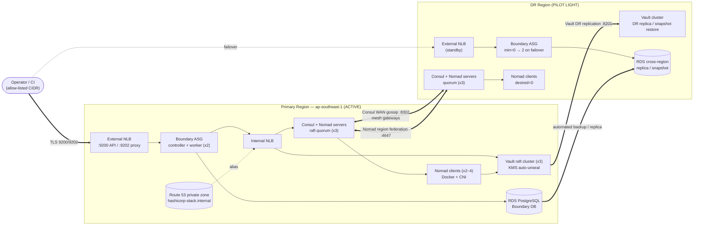
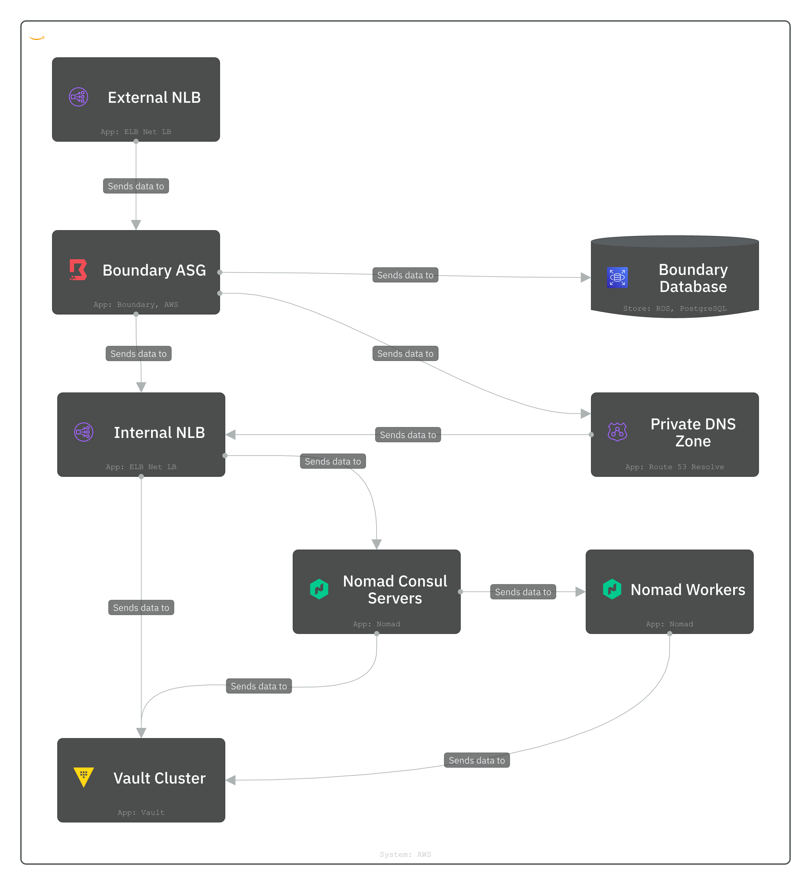
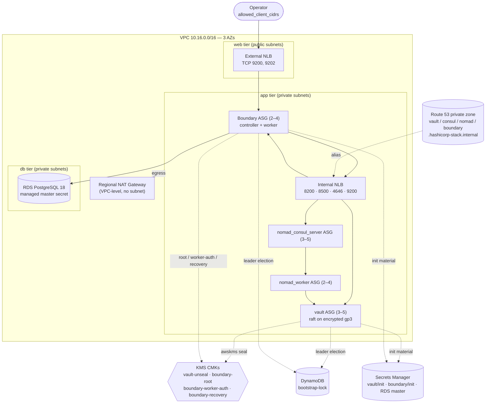
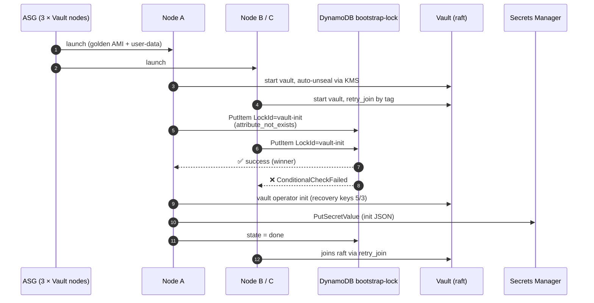
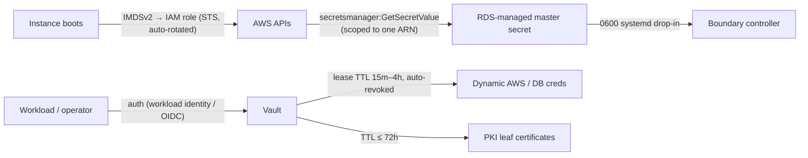

# HashiCorp Stack on AWS — Federated Platform with Pilot-Light DR


An enterprise infrastructure platform that runs the full HashiCorp runtime (**Consul, Nomad, Vault, Boundary**) on AWS EC2. Packer builds immutable golden images and Terraform provisions the platform. The platform uses a **zero-trust architecture**: no instance has a public IP, there are no bastion hosts, and no static credentials are baked into images or state. The target topology is a **federated control plane** across a primary region and a **pilot-light disaster-recovery** region.

> [!IMPORTANT]
> **Implementation status.** The primary region (`ap-southeast-1`) is fully provisioned by this repository: VPC, private DNS, KMS, RDS, four Auto Scaling groups, internal and external NLBs, and automated cluster bootstrap. WAN federation, the DR region, Vault secrets engines, Boundary targets and Nomad workloads are **target state**. They are marked 🚧 throughout this document, and the [Roadmap](#11-roadmap) tracks them.

---

## Table of Contents

1. [Architecture Overview](#1-architecture-overview)
2. [Core Architectural Components](#2-core-architectural-components)
3. [Repository Layout](#3-repository-layout)
4. [Prerequisites](#4-prerequisites)
5. [Bootstrapping & Deployment Order](#5-bootstrapping--deployment-order)
6. [Disaster Recovery & Failover Runbook](#6-disaster-recovery--failover-runbook)
7. [Security & Compliance Framework](#7-security--compliance-framework)
8. [Network & Port Reference](#8-network--port-reference)
9. [Operations](#9-operations)
10. [Known Limitations](#10-known-limitations)
11. [Roadmap](#11-roadmap)

---

## 1. Architecture Overview

The platform is split into a **control plane** and a **data plane**:

- **Control plane.** Consul and Nomad servers, the Vault raft cluster and the Boundary controllers. Each runs in its own Auto Scaling group across three Availability Zones.
- **Data plane.** Nomad clients running Docker workloads with CNI bridge networking, registered in the Consul service catalog.

All inbound operator traffic enters through one internet-facing NLB. That NLB is locked to an allow-list of client CIDRs and forwards only to Boundary. Everything else is reachable only through the internal NLB, via `*.hashicorp-stack.internal` records in a Route 53 private hosted zone.

In the target state, a second region runs a **pilot-light** copy of the control plane. Its Consul and Nomad servers and Vault run at minimum quorum, Nomad client capacity is scaled to zero, and it is WAN-federated with the primary region. Failover then becomes a capacity operation rather than a rebuild.

### Key Metrics (Design Targets)

| Metric | Target | Mechanism |
| :-- | :-- | :-- |
| **RTO** | **< 30 min** | Pilot-light control plane is already running and federated; failover scales ASGs and flips DNS |
| **RPO** | **15 min** | Scheduled raft snapshots (Vault, Consul, Nomad) plus cross-region RDS automated backups |
| **DR cost** | **~80% lower than active-active** | DR region runs quorum-only servers and no Nomad client fleet |
| **Cold start** | **< 30 min** | Immutable AMIs, tag-based `retry_join` and DynamoDB-elected bootstrap, with no manual cluster formation |
| **Node boot** | **~3 min** | All binaries, CNI plugins and system users are baked in; user-data only renders config |

> These are architectural targets for the federated design. They have not been measured in this repository yet. Validate them with a game-day exercise before relying on them (see [§6.5](#65-validation--game-days)).

### 1.1 Target Topology — Federated Primary + Pilot-Light DR 🚧



### 1.2 As-Built — Primary Region ✅

The diagram below shows what `terraform apply` provisions today.





---

## 2. Core Architectural Components

### 2.1 Packer — Immutable Golden AMI Pipeline ✅

Every node boots from a pre-baked, versioned AMI built on the latest Canonical **Ubuntu 26.04** image (owner `099720109477`). The runtime never runs `apt-get` at boot. User-data only renders configuration and starts services, which is what keeps node boot time near the **~3 min** target.

| Template | AMI name | `Role` tag | Contents |
| :-- | :-- | :-- | :-- |
| [`packer/nomad-consul`](packer/nomad-consul/packer.pkr.hcl) (server) | `nomad-consul-server-YYYY-MM-DD` | `nomad-consul-control-plane` | Consul, Nomad, CNI plugins `v1.6.2`, bridge `sysctl`s, AWS CLI |
| [`packer/nomad-consul`](packer/nomad-consul/packer.pkr.hcl) (client) | `nomad-consul-client-YYYY-MM-DD` | `nomad-consul-client-plane` | Above plus Docker CE / containerd |
| [`packer/vault`](packer/vault/build.pkr.hcl) | `vault-server-YYYY-MM-DD` | `vault-control-plane` | Vault, AWS CLI |
| [`packer/boundary`](packer/boundary/build.pkr.hcl) | `boundary-server-YYYY-MM-DD` | `boundary-plane` | Boundary, `postgresql-client`, AWS CLI |

Every image includes the **AWS CLI** (`snap install aws-cli --classic`). User-data needs it for the DynamoDB bootstrap election and for Secrets Manager reads and writes.

Terraform resolves AMIs by **`Role` + `BuiltBy=packer` tags**, not by name. This decouples image naming from infrastructure code, and a new bake is picked up on the next apply with no code change.

### 2.2 Terraform — Modular Provisioning ✅

The root module [`terraform/main.tf`](terraform/main.tf) composes four reusable modules:

| Module | Responsibility |
| :-- | :-- |
| [`vpc`](terraform/modules/vpc) | 3-AZ VPC (`10.16.0.0/16`) with `reserved` / `db` / `app` / `web` tiers, IGW, **regional NAT gateway**, and a Route 53 private hosted zone |
| [`kms`](terraform/modules/kms) | Customer-managed keys with annual rotation and a 30-day deletion window, instantiated 4×: `vault-unseal`, `boundary-root`, `boundary-worker-auth`, `boundary-recovery` |
| [`rds`](terraform/modules/rds) | PostgreSQL 18 for Boundary. The master password is **managed by RDS in Secrets Manager** and never enters Terraform state. 7-day PITR backups, deletion protection by default, optional Multi-AZ and read replicas |
| [`ec2`](terraform/modules/ec2) | Four ASGs with launch templates, per-role IAM, security groups, internal and external NLBs, service DNS records, and the bootstrap lock table and init secrets |

Each module has its own README covering inputs, outputs, design decisions and known limitations.

**Remote state:** S3 backend (`hashicorp-stack-04321`), server-side encrypted, using **S3-native state locking** (`use_lockfile = true`), which removes the need for a DynamoDB lock table. DynamoDB is used elsewhere, for cluster bootstrap leader election (§2.7).

**Guardrails as code:** input validation in the `ec2` module rejects unsafe topologies at plan time:

- `nomad_consul_server` and `vault` must have `min_size >= 3` (raft quorum).
- Raft members cannot run on Spot capacity, because an interruption would be an unplanned quorum loss.
- Vault requires a dedicated `data_volume_size`, so raft state never lives on the root disk.
- `desired_capacity` must sit between `min_size` and `max_size`.

### 2.3 Consul — Service Discovery & Mesh

| Capability | Status |
| :-- | :-- |
| 3-server raft cluster, `bootstrap_expect = 3`, datacenter `dc1` | ✅ |
| Cloud auto-join (`provider=aws tag_key=Role tag_value=nomad_consul_server`) | ✅ |
| Client agents on Nomad workers and Boundary nodes | ✅ |
| Private DNS `consul.hashicorp-stack.internal` → internal NLB `:8500` | ✅ |
| Gossip encryption, TLS, ACLs (default-deny) | 🚧 |
| Connect service mesh with mTLS sidecars (Envoy) | 🚧 |
| **WAN federation** via mesh gateways (`:8302`, primary ↔ DR) | 🚧 |

### 2.4 Nomad — Federated Scheduling

| Capability | Status |
| :-- | :-- |
| 3 servers co-located with Consul servers, Consul-assisted auto-join | ✅ |
| 2–4 clients with the Docker driver (`allow_privileged = false`) and CNI bridge networking | ✅ |
| Client alloc directory on a dedicated EBS volume when `data_volume_size` is set | ✅ |
| Client `meta` stamped with `instance_id` and `az` for spread and affinity constraints | ✅ |
| ACLs, TLS, Vault workload identity | 🚧 |
| **Multi-region federation** (`nomad server join` across regions, `multiregion` jobs) | 🚧 |

### 2.5 Vault — Dynamic Secrets Engine

| Capability | Status |
| :-- | :-- |
| 3-node **integrated raft** storage on encrypted gp3, autopilot dead-server cleanup | ✅ |
| **AWS KMS auto-unseal** (`seal "awskms"`), so no operator unseal ceremony | ✅ |
| Automated `vault operator init`: 5 recovery shares, threshold 3, written to KMS-encrypted Secrets Manager | ✅ |
| Tag-based `retry_join` so new nodes join raft automatically | ✅ |
| PKI secrets engine for TLS across Consul, Nomad, Vault and Boundary | 🚧 |
| Dynamic **AWS** credentials and **database** credential leases (short TTL) | 🚧 |
| Vault Performance/DR replication to the DR region | 🚧 |

### 2.6 Boundary — Zero-Trust Access Gateway

| Capability | Status |
| :-- | :-- |
| Controller + worker co-located per instance, 2–4 node ASG | ✅ |
| Only public ingress to the platform: external NLB `:9200` (API) and `:9202` (proxy), restricted to `allowed_client_cidrs` | ✅ |
| Three separate KMS keys: `root` (encrypts DB-stored secrets), `worker-auth`, `recovery` (break-glass) | ✅ |
| DB URL built at boot from the RDS-managed secret, injected via a `0600` systemd drop-in, never written to `boundary.hcl` | ✅ |
| Automated `boundary database init` via DynamoDB election, with output written to Secrets Manager | ✅ |
| OIDC auth method, host catalogs, targets, Vault credential brokering / injection | 🚧 |

**No bastion hosts. No SSH keys** (`key_name` defaults to `null`). Operators reach private services only through Boundary sessions, with **AWS SSM Session Manager** as the audited break-glass path.

### 2.7 Cold-Start Orchestration ✅

Clusters form from zero with no human in the loop:



Boundary uses the same pattern (`LockId=boundary-db-init`). Losers poll until the lock reaches `done`, then start the `boundary` service, so exactly one node runs schema migrations.

---

## 3. Repository Layout

```text
.
├── README.md                         # This document
├── architecture.png                  # As-built architecture diagram
│
├── packer/                           # Immutable Image Bakery ✅
│   ├── nomad-consul/
│   │   ├── packer.pkr.hcl            # server + client AMI builds
│   │   ├── variables.pkr.hcl
│   │   └── scripts/
│   │       ├── control-plane.sh      # Consul + Nomad + CNI
│   │       └── worker-plane.sh       # + Docker CE / containerd
│   ├── vault/
│   │   ├── build.pkr.hcl
│   │   ├── variables.pkr.hcl
│   │   └── scripts/install.sh
│   └── boundary/
│       ├── build.pkr.hcl
│       ├── variable.pkr.hcl
│       └── scripts/install.sh
│
├── terraform/                        # Infrastructure Provisioning ✅
│   ├── main.tf                       # Root composition (primary region)
│   ├── providers.tf                  # AWS ~> 6.0, S3 backend + native lockfile
│   ├── variables.tf                  # region, allowed_client_cidrs
│   ├── outputs.tf                    # boundary_addr, service_endpoints, AMI IDs
│   └── modules/
│       ├── vpc/                      # 3-AZ, 4-tier VPC + private hosted zone
│       ├── kms/                      # CMK + alias (rotation enabled)
│       ├── rds/                      # PostgreSQL, managed master secret
│       └── ec2/                      # ASGs, NLBs, IAM, SGs, bootstrap
│           └── templates/user_data.sh.tftpl
│       # each module: main.tf · variables.tf · outputs.tf · providers.tf · README.md
│
│   # ─── Target layout 🚧 ───────────────────────────────────────────
│   ├── environments/
│   │   ├── primary/                  # ap-southeast-1 — active
│   │   └── dr/                       # secondary region — pilot light
├── nomad-jobs/                       # Workload job specifications
├── vault-policies/                   # HCL policies + engine configuration
└── scripts/                          # Federation, snapshot and failover automation
```

---

## 4. Prerequisites

| Tool | Version | Notes |
| :-- | :-- | :-- |
| Terraform | ≥ 1.10 | Required for S3-native `use_lockfile` |
| Packer | ≥ 1.10 | `github.com/hashicorp/amazon ~> 1.8` |
| AWS CLI | v2 | Named profiles `packer` and `terraform` |
| Session Manager plugin | latest | Break-glass shell access |
| `boundary`, `vault`, `consul`, `nomad` CLIs | latest | Operator workstation |

**AWS setup:**

```bash
# Profiles referenced by the Packer sources and the Terraform provider
aws configure --profile packer
aws configure --profile terraform

# One-time: state bucket (versioning is strongly recommended)
aws s3api create-bucket --bucket hashicorp-stack-04321 \
  --region ap-southeast-1 \
  --create-bucket-configuration LocationConstraint=ap-southeast-1 \
  --profile terraform
aws s3api put-bucket-versioning --bucket hashicorp-stack-04321 \
  --versioning-configuration Status=Enabled --profile terraform
```

---

## 5. Bootstrapping & Deployment Order

The steps below have hard dependencies and must run in order. Steps 1–2 are fully automated today. Steps 3–5 are the target-state procedure.

### Step 1 — Immutable Image Bakery ✅

Bake all four AMIs in the target region. Terraform's AMI lookup fails if any role is missing.

```bash
for img in nomad-consul vault boundary; do
  (cd packer/$img && packer init . && packer validate . && packer build .)
done

# Verify the Role tags Terraform will resolve
aws ec2 describe-images --owners self --profile packer \
  --filters Name=tag:BuiltBy,Values=packer \
  --query 'Images[].[Name,Tags[?Key==`Role`].Value|[0],CreationDate]' --output table
```

For the DR region 🚧, copy the images instead of rebuilding them, so both regions run bit-identical artifacts:

```bash
aws ec2 copy-image --source-region ap-southeast-1 --region <dr-region> \
  --source-image-id <ami-id> --name <same-name> --copy-image-tags
```

### Step 2 — VPC & Control-Plane Provisioning ✅

```bash
cd terraform
cat > terraform.tfvars <<EOF      # gitignored
allowed_client_cidrs = ["$(curl -s https://checkip.amazonaws.com)/32"]
EOF

terraform init
terraform plan -out=tfplan
terraform apply tfplan
```

Terraform creates, in dependency order, the VPC and private zone, then the KMS keys and RDS, then the IAM, launch templates, ASGs and NLBs. Cold-start orchestration (§2.7) then forms the Consul, Nomad and Vault raft clusters and migrates the Boundary schema without operator input.

Verify from inside the VPC (SSM):

```bash
terraform output service_endpoints
aws ssm start-session --target <instance-id> --profile terraform

consul members
nomad server members && nomad node status
VAULT_ADDR=http://vault.hashicorp-stack.internal:8200 vault status   # Sealed=false, HA Enabled=true
```

Retrieve bootstrap material. This is highly sensitive, so rotate or revoke it once permanent auth is in place:

```bash
aws secretsmanager list-secrets --filters Key=name,Values=hashicorp-stack/ --profile terraform
aws secretsmanager get-secret-value --secret-id <vault-init-arn>    --query SecretString --output text
aws secretsmanager get-secret-value --secret-id <boundary-init-arn> --query SecretString --output text
```

### Step 3 — WAN Federation 🚧

After the DR environment is applied, with a VPC CIDR that does **not** overlap `10.16.0.0/16` and inter-region connectivity (Transit Gateway or VPC peering) in place:

```bash
# Consul: join DR servers to the primary WAN pool (or configure mesh gateways + primary_datacenter)
consul join -wan <primary-consul-server-ip>
consul members -wan                       # both datacenters listed

# Nomad: federate regions
nomad server join <primary-nomad-server-ip>:4648
nomad server members                      # servers from both regions
nomad status -region=<dr-region>
```

Production posture: federate through **Consul mesh gateways** with `primary_datacenter` set, and enable ACL replication so that DR tokens resolve locally while the primary is down.

### Step 4 — Vault Engines & Boundary Sessions 🚧

```bash
export VAULT_ADDR=http://vault.hashicorp-stack.internal:8200
vault login <root-token-from-secrets-manager>

# PKI: root + intermediate for platform-wide TLS
vault secrets enable pki && vault secrets tune -max-lease-ttl=87600h pki
vault write pki/root/generate/internal common_name=hashicorp-stack.internal ttl=87600h
vault secrets enable -path=pki_int pki
vault write pki_int/roles/platform allowed_domains=hashicorp-stack.internal \
  allow_subdomains=true max_ttl=72h

# Dynamic AWS credentials (STS assumed-role, 15 min TTL)
vault secrets enable aws
vault write aws/roles/deploy credential_type=assumed_role \
  role_arns=<deploy-role-arn> default_sts_ttl=15m max_sts_ttl=1h

# Dynamic database credentials
vault secrets enable database
vault write database/roles/app-ro db_name=app default_ttl=1h max_ttl=4h \
  creation_statements="CREATE ROLE \"{{name}}\" WITH LOGIN PASSWORD '{{password}}' VALID UNTIL '{{expiration}}'; GRANT SELECT ON ALL TABLES IN SCHEMA public TO \"{{name}}\";"

# Revoke the root token once an admin auth method exists
vault token revoke -self
```

```bash
export BOUNDARY_ADDR=$(terraform -chdir=terraform output -raw boundary_addr)
boundary authenticate password -auth-method-id <from boundary-init secret> -login-name admin

# Vault credential store → brokered, short-lived credentials per session
boundary credential-stores create vault -scope-id <project-id> \
  -vault-address http://vault.hashicorp-stack.internal:8200 -vault-token <periodic-orphan-token>

boundary targets create tcp -name nomad-ui -scope-id <project-id> \
  -address nomad.hashicorp-stack.internal -default-port 4646
boundary connect -target-id <target-id>
```

### Step 5 — Workload Deployment 🚧

```hcl
# nomad-jobs/example.nomad.hcl
job "web" {
  datacenters = ["dc1"]
  type        = "service"

  group "web" {
    count = 2

    spread { attribute = "${meta.az}" }       # set on every client by user-data

    network {
      mode = "bridge"
      port "http" { to = 8080 }
    }

    service {
      name = "web"
      port = "http"
      connect { sidecar_service {} }          # Consul mesh mTLS
    }

    task "app" {
      driver = "docker"
      config { image = "nginxinc/nginx-unprivileged:stable" }
      vault  { role = "web" }                 # workload identity → dynamic secrets
    }
  }
}
```

```bash
export NOMAD_ADDR=http://nomad.hashicorp-stack.internal:4646
nomad job plan nomad-jobs/example.nomad.hcl
nomad job run  nomad-jobs/example.nomad.hcl
```

---

## 6. Disaster Recovery & Failover Runbook

> 🚧 This runbook describes the target pilot-light procedure. It requires the DR environment, WAN federation and snapshot automation from the [Roadmap](#11-roadmap).

### 6.1 Steady State — Pilot Light

| Component | Primary | DR (pilot light) |
| :-- | :-- | :-- |
| Consul/Nomad servers | 3 | 3 (quorum only, smallest viable instance type) |
| Vault | 3, active | 3, DR-secondary replica **or** cold (restore from snapshot) |
| Nomad clients | 2–4 | **0** |
| Boundary | 2–4 | **0** (ASG and launch template pre-staged) |
| RDS | primary | cross-region automated backups / read replica |
| AMIs | baked | copied, same tags |

### 6.2 Failover Decision Criteria

Declare a regional failover when **any** of the following holds for more than 10 minutes and is confirmed by two independent signals (CloudWatch and synthetic probe):

- Loss of quorum on Vault **or** the Consul/Nomad servers in the primary region.
- Primary-region AWS service event affecting EC2, EBS or ELB in two or more AZs.
- The external NLB is unreachable from all probe locations.

### 6.3 Failover Procedure (RTO budget: 30 min)

| T+ | Step | Command / Action |
| :-- | :-- | :-- |
| 0–3 | **Declare & freeze.** Incident commander assigned. Freeze all Terraform applies against primary. | Page on-call; lock the pipeline |
| 3–8 | **Promote Vault.** Generate a DR operation token from recovery keys, then promote. If Vault in DR is cold, restore the latest raft snapshot instead. | `vault operator generate-root -dr-token` → `vault write sys/replication/dr/secondary/promote dr_operation_token=…`<br/>or `vault operator raft snapshot restore -force latest.snap` |
| 8–12 | **Promote the database.** | `aws rds promote-read-replica --db-instance-identifier hashicorp-stack-dr`<br/>or `restore-db-instance-to-point-in-time` from replicated backups |
| 12–20 | **Scale the data plane.** Boot Nomad clients and Boundary from pre-copied golden AMIs (~3 min boot). | `terraform -chdir=terraform/environments/dr apply -var failover=true`<br/>(sets `nomad_worker` / `boundary` desired capacity to production levels) |
| 20–25 | **Reschedule workloads.** | `nomad job run -region=<dr-region> nomad-jobs/*.nomad.hcl`<br/>`nomad job status -region=<dr-region>` |
| 25–28 | **Cut over traffic.** Update the Route 53 public record / client `BOUNDARY_ADDR` to the DR external NLB. | Route 53 failover record or weighted switch |
| 28–30 | **Verify.** | `vault status` · `consul members -wan` · `nomad node status` · `boundary authenticate` · synthetic checks green |

### 6.4 Failback

1. Rebuild the primary from code: `terraform apply` in `environments/primary` (golden AMIs, same modules).
2. Re-establish Vault replication with the **DR region as primary**, let it sync, then perform a planned demote/promote.
3. Re-seed the RDS replica into the primary region and schedule a planned switchover.
4. Drain DR Nomad clients (`nomad node drain -enable`) and scale DR back to pilot light.
5. Complete a post-incident review within 5 business days.

### 6.5 Validation & Game Days

- **Quarterly:** full regional failover game day. Record the actual RTO and RPO against the §1 targets.
- **Monthly:** restore the latest Vault and Consul snapshots into an isolated account and verify integrity.
- **Continuously:** alert if the newest snapshot is older than the RPO (15 min).

```bash
# Snapshot jobs (to be wired as Nomad periodic batch jobs → S3 with CRR)
vault operator raft snapshot save vault-$(date +%s).snap
consul snapshot save consul-$(date +%s).snap
nomad operator snapshot save nomad-$(date +%s).snap
```

---

## 7. Security & Compliance Framework

### 7.1 Zero-Trust Access Model

| Control | Implementation | Status |
| :-- | :-- | :-- |
| No public instances | All ASGs are in app-tier private subnets. Only the external NLB lives in the web tier | ✅ |
| Minimal internet exposure | External NLB SG allows only `allowed_client_cidrs` on 9200/9202 | ✅ |
| No bastions / SSH keys | `key_name = null`; access via Boundary sessions or SSM (audited in CloudTrail) | ✅ |
| Identity-based sessions | Boundary OIDC auth, RBAC per scope, session recording | 🚧 |
| Credential brokering | Boundary ↔ Vault credential store: users never see target credentials | 🚧 |

### 7.2 Secret Lifecycle — Zero Static Credentials



- **No long-lived secrets in code, AMIs or Terraform state.** The RDS password uses `manage_master_user_password`, and instances authenticate to AWS with IAM instance-profile credentials only.
- **Least-privilege IAM per role.** Only Boundary can read the DB secret, only Vault can use the unseal key, and only bootstrap-eligible roles can write their own init secret.
- **Short-lived leases** 🚧. Every dynamic credential carries a TTL and is revoked at lease expiry or on `vault lease revoke -prefix` during an incident.
- **Bootstrap material** (Vault recovery keys and root token, Boundary initial admin) is encrypted with dedicated CMKs, has a 7-day recovery window, and **must be rotated or revoked after day-0**.

### 7.3 Encryption

| Layer | Mechanism | Status |
| :-- | :-- | :-- |
| EBS (root + raft/alloc data) | `encrypted = true`, optional CMK via `kms_key_arns.ebs` | ✅ |
| Vault barrier | AWS KMS auto-unseal (`alias/vault-unseal`) | ✅ |
| Boundary DB secrets | KMS `root` key (envelope encryption per scope) | ✅ |
| Boundary worker auth | KMS `worker-auth` key | ✅ |
| RDS at rest / in transit | `storage_encrypted`; Boundary connects with `sslmode=require` | ✅ |
| Terraform state | S3 SSE (`encrypt = true`) | ✅ |
| KMS key rotation | Annual automatic rotation, 30-day deletion window | ✅ |
| Service mTLS (Consul Connect, Nomad RPC, Vault/Boundary listeners) | Vault PKI-issued certificates | 🚧 |
| Consul gossip encryption | 32-byte gossip key from Vault | 🚧 |

### 7.4 Host Hardening

- **IMDSv2 enforced** (`http_tokens = required`, hop limit 2), which mitigates SSRF credential theft.
- Services run as **dedicated non-login system users** (`consul`, `nomad`, `vault`, `boundary`) with `0750` data directories.
- Nomad Docker driver runs with **`allow_privileged = false`**.
- Images are **immutable**. Patching means re-baking and rolling out through ASG instance refresh (`min_healthy_percentage = 66`), never SSH-and-patch.

### 7.5 Compliance Mapping (Indicative)

| Control family | SOC 2 / ISO 27001 intent | Platform evidence |
| :-- | :-- | :-- |
| Access control | CC6.1 / A.9 | Boundary RBAC, no SSH keys, SSM + CloudTrail |
| Cryptography | CC6.7 / A.10 | KMS CMKs with rotation, TLS/mTLS |
| Change management | CC8.1 / A.12.1.2 | Terraform plan/apply, immutable AMIs |
| Business continuity | A1.2 / A.17 | Pilot-light DR, snapshot RPO, game days |
| Secrets management | CC6.1 / A.9.4 | Vault dynamic leases, no static credentials |

---

## 8. Network & Port Reference

| Service | Port(s) | Protocol | Exposed via |
| :-- | :-- | :-- | :-- |
| Consul server RPC / Serf LAN / Serf WAN | 8300 / 8301 / 8302 | TCP (+UDP gossip) | VPC-internal |
| Consul HTTP / HTTPS / gRPC / DNS | 8500 / 8501 / 8502 / 8600 | TCP (+UDP DNS) | Internal NLB `:8500` |
| Nomad HTTP / RPC / Serf | 4646 / 4647 / 4648 | TCP (+UDP Serf) | Internal NLB `:4646` |
| Vault API / cluster | 8200 / 8201 | TCP | Internal NLB `:8200` |
| Boundary API / cluster / proxy | 9200 / 9201 / 9202 | TCP | Internal NLB `:9200`; **External NLB `:9200`, `:9202`** |
| PostgreSQL (RDS) | 5432 | TCP | Boundary SG → RDS SG only |

**Private DNS** (`hashicorp-stack.internal`, aliases onto the internal NLB): `vault.`, `consul.`, `nomad.`, `boundary.`

**Subnet tiers** (per AZ, ×3): `reserved` · `db` · `app` (all ASGs + internal NLB) · `web` (external NLB only). Private egress goes through one regional NAT gateway, which spans AZs and isn't placed in a subnet.

---

## 9. Operations

**Rolling a new golden image:**

```bash
(cd packer/vault && packer build .)                         # new AMI, same Role tag
terraform -chdir=terraform apply                           # launch template → new version
aws autoscaling start-instance-refresh --auto-scaling-group-name <vault-asg> \
  --preferences MinHealthyPercentage=66                    # or set instance_refresh_enabled = true
```

For raft clusters, roll **one node at a time** and confirm `vault operator raft list-peers` / `consul operator raft list-peers` show a healthy quorum between replacements.

**Useful outputs:**

```bash
terraform -chdir=terraform output boundary_addr           # export as BOUNDARY_ADDR
terraform -chdir=terraform output service_endpoints       # private service URLs
terraform -chdir=terraform output ec2_ami_ids             # AMIs resolved per role
```

**Troubleshooting a node:** `journalctl -u <service>`, `/var/log/user-data.log`, `systemctl status vault-bootstrap boundary-bootstrap`.

**Teardown:**

```bash
terraform -chdir=terraform destroy
# Secrets Manager init secrets enter a 7-day recovery window; KMS keys a 30-day deletion window.
# With deletion_protection = true, first apply it as false, then destroy.
```

---

## 10. Known Limitations

These reflect the **bootstrap posture** of the current code. Resolve them before production traffic:

- **TLS is disabled** on Vault, Boundary and Consul listeners, and Consul has no gossip encryption or ACLs yet. The next milestone issues this material from Vault PKI.
- **RDS** runs single-AZ (`multi_az = false`), and the root sets `skip_final_snapshot = true` and `deletion_protection = false` so the stack can be torn down cleanly. For production, enable Multi-AZ, set `skip_final_snapshot = false`, and remove the `deletion_protection` override (the module defaults to `true`).
- The **external NLB is TCP pass-through** to plaintext Boundary listeners. Restrict `allowed_client_cidrs` tightly until TLS is enabled.
- Default instance type is `t3.micro`, which is suitable for evaluation only. Size node groups via `node_groups` in `terraform/main.tf`.
- **Single region.** There is no DR, federation or snapshot automation yet (see the Roadmap).

---

## 11. Roadmap

| # | Milestone | Scope |
| :-- | :-- | :-- |
| 1 | **Transport security** | Vault PKI → TLS on every listener, Consul gossip key, ACLs (default-deny) for Consul and Nomad |
| 2 | **Environments split** | `terraform/environments/{primary,dr}` consuming shared modules; non-overlapping CIDRs; TGW/peering |
| 3 | **WAN federation** | Consul mesh gateways + ACL replication; Nomad multi-region |
| 4 | **Vault engines & policies** | `vault-policies/`; PKI, AWS, database engines; Nomad workload identity |
| 5 | **Boundary targets** | OIDC, host catalogs (AWS plugin), Vault credential injection, session recording |
| 6 | **Workloads** | `nomad-jobs/` with Connect sidecars and Vault-templated secrets |
| 7 | **DR automation** | Scheduled raft snapshots → S3 CRR, Vault DR replication, RDS cross-region, `scripts/failover.sh` |
| 8 | **Validation** | Game-day results recorded against RTO/RPO targets; CI (`fmt`, `validate`, `tflint`, `checkov`, `packer validate`) |

---

