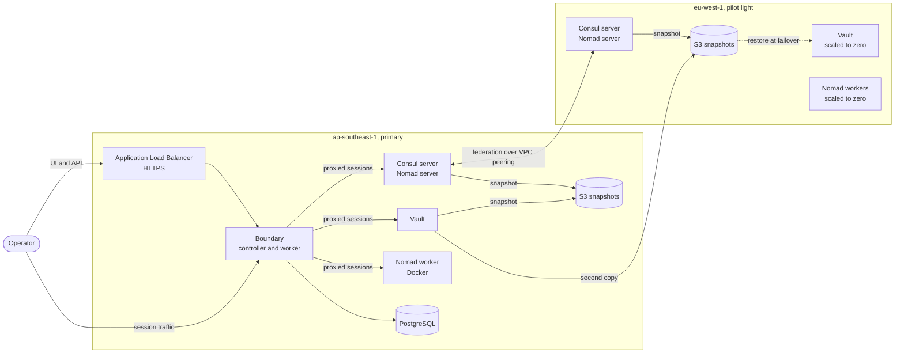

# The HashiCorp Stack


A self-hosted, two-region platform on AWS built entirely from HashiCorp's
community editions: Consul for service discovery, Nomad for workload
scheduling, Vault for secrets, and Boundary for access. Packer bakes the
machine images and one Terraform root provisions both regions.

The primary region runs the full platform. The second region is a pilot light:
one small server stays on and federated, and everything else is scaled to zero
with its data already replicated there.

## Architecture



| Node group | Runs | Primary | Pilot light |
|---|---|---|---|
| `nomad_consul_server` | Consul server, Nomad server | 1 | 1 |
| `vault` | Vault with integrated Raft storage, Consul client | 1 | 0, scaled up at failover |
| `nomad_worker` | Nomad client, Docker, Consul client | 1 | 0, scaled up at failover |
| `boundary` | Boundary controller and worker, Consul client | 1 | not deployed yet |

Each group is an Auto Scaling group, sized for an account limited to 8 vCPU per
region. The modules accept 1, 3 or 5 servers per Raft group, and each group
takes its own instance type.

## Design principles

- **One way in.** Only Boundary is published, over HTTPS, to an allow-list of
  client addresses. Vault, Nomad, Consul and every host are reached through it.
- **No SSH key pairs.** Instances launch without one. Systems Manager is the
  break-glass path.
- **Immutable images.** Software is installed at image build time. Instances
  only receive configuration at boot.
- **Discovery through Consul.** Nodes find their cluster by cloud auto-join
  tags and find services as `*.service.consul`, including across regions as
  `*.service.<datacenter>.consul`.
- **State outlives instances.** Vault, Consul and Nomad snapshot to S3 every
  10 minutes, and a replacement node restores the latest snapshot on first
  boot. Replacing a node is a routine operation.
- **No secrets in Terraform state.** The database password and the Vault and
  Boundary bootstrap credentials are generated outside state and kept in
  Secrets Manager.
- **One KMS key per purpose.** Vault's unseal key is multi-region, so a
  snapshot taken in one region unseals in the other.
- **Federated, not stretched.** Each region is its own Consul datacenter and
  Nomad region with its own Raft cluster. They share discovery and job
  submission, not state.

## Prerequisites

| Requirement | Detail |
|---|---|
| Terraform | 1.11 or later |
| Packer | With the `amazon` plugin, `~> 1.8` |
| AWS CLI | A current version 2, plus the Session Manager plugin |
| Boundary CLI | Or the Boundary Desktop app, to open sessions |
| `jq` | Used by the commands in this README |
| AWS profiles | `packer` for image builds and `terraform` for provisioning |
| Domain | A Route 53 public hosted zone that already exists |
| Quota | 8 on-demand vCPU in each region |

## 1. Build the images

Four images, each from Ubuntu 26.04 on amd64. Terraform selects the newest
image for each role by its `Role` tag, in whichever region it is deploying to.

| Image | `Role` tag | Installed | Needed in |
|---|---|---|---|
| Control plane | `nomad-consul-control-plane` | Consul, Nomad | both regions |
| Worker | `nomad-consul-client-plane` | Consul, Nomad, Docker | both regions |
| Vault | `vault-control-plane` | Vault, Consul | both regions |
| Boundary | `boundary-plane` | Boundary, Consul, PostgreSQL client | primary |

Every image also carries the AWS CLI and `jq`, `.consul` DNS forwarding to the
local Consul agent, and trust for Vault's SSH certificate authority. Services
are installed but left disabled, so nothing starts before its configuration is
written at boot.

From each image's directory:

```bash
packer init .
packer build .
```

`ami_regions` copies each finished image, with its tags, to `eu-west-1`. A
build launches a temporary instance, so it needs free vCPU quota in the
primary region.

```bash
# confirm what each region has
for r in ap-southeast-1 eu-west-1; do
  aws ec2 describe-images --region "$r" --owners self \
    --filters "Name=tag:BuiltBy,Values=packer" \
    --query 'sort_by(Images, &CreationDate)[].[Tags[?Key==`Role`]|[0].Value, ImageId, CreationDate]' \
    --output table
done
```

## 2. Provision both regions

Create `terraform.tfvars` in the Terraform root. Keep it out of version control.

```hcl
hashicorp_stack_domain = "example.com"
allowed_client_cidrs   = ["203.0.113.10/32"]
```

```bash
terraform init
terraform apply
```

One apply builds both regions. Vault and Boundary initialize themselves on
first boot; allow about five minutes before logging in.

### Variables

| Name | Default | Description |
|---|---|---|
| `region` | `ap-southeast-1` | Primary region. Also the Consul datacenter and Nomad region name. |
| `pilot_light_region` | `eu-west-1` | Pilot-light region, named the same way. |
| `hashicorp_stack_domain` | required | Public hosted zone. Boundary is published at `boundary.<domain>`. |
| `allowed_client_cidrs` | required | Addresses allowed to reach the load balancer and the Boundary worker. |

### Modules

| Module | Purpose | Used in |
|---|---|---|
| `vpc` | Three-tier network across three zones, NAT gateway, private hosted zone | both regions |
| `vpc_peering` | Peering connection and routes between the two VPCs | once, spanning both |
| `kms` | One customer-managed key per purpose | primary, four keys |
| `kms_replica` | Replica of the multi-region Vault unseal key | pilot light |
| `rds` | PostgreSQL for Boundary, with the password kept out of state | primary |
| `s3` | Private, encrypted snapshot bucket with expiring history | both regions |
| `secrets` | Init secrets for Vault and Boundary; Vault's is replicated | primary |
| `alb` | Public load balancer, wildcard certificate and DNS records | primary |
| `ec2` | Node groups, IAM roles, first-boot init, snapshots and restore | both regions |

The second region is the same modules called again through a provider alias,
`aws.pilot_light`.

## 3. Working with the platform

Set these once per shell. Every command in this README uses them, and none of
them depends on Terraform outputs.

```bash
export PROJECT=hashicorp-stack PRIMARY=ap-southeast-1 PILOT=eu-west-1

# node_id <region> <role>   roles: nomad_consul_server, nomad_worker, vault, boundary
node_id() {
  aws ec2 describe-instances --region "$1" \
    --filters "Name=tag:Project,Values=$PROJECT" "Name=tag:Role,Values=$2" \
              "Name=instance-state-name,Values=running" \
    --query 'Reservations[].Instances[].InstanceId' --output text
}

# shell <region> <role>     open a shell on that node
shell() { aws ssm start-session --region "$1" --target "$(node_id "$1" "$2")"; }

# asg <region> <role>       name of that role's Auto Scaling group
asg() {
  aws autoscaling describe-auto-scaling-groups --region "$1" \
    --query "AutoScalingGroups[?starts_with(AutoScalingGroupName, '$PROJECT-$2-')].AutoScalingGroupName | [0]" \
    --output text
}

# bucket <region>           name of that region's snapshot bucket
bucket() {
  aws s3api list-buckets --prefix "$PROJECT-snapshots-" --bucket-region "$1" \
    --query 'Buckets[0].Name' --output text
}

# secret <vault|boundary> [region]   print an init secret as JSON
secret() {
  local region="${2:-$PRIMARY}" arn
  arn=$(aws secretsmanager list-secrets --region "$region" \
    --filters Key=name,Values="$PROJECT/$1/init-" \
    --query 'sort_by(SecretList, &CreatedDate)[-1].ARN' --output text)
  aws secretsmanager get-secret-value --region "$region" --secret-id "$arn" \
    --query SecretString --output text
}

# replace <region> <role>   terminate the node; its group launches a new one
replace() {
  date -u
  aws autoscaling terminate-instance-in-auto-scaling-group --region "$1" \
    --instance-id "$(node_id "$1" "$2")" --no-should-decrement-desired-capacity
}
```

### Log in

```bash
secret boundary | jq '.auth_method'      # auth_method_id, login_name, password
secret vault | jq -r '.root_token'       # Vault root token
secret vault "$PILOT" | jq -r '.root_token'   # the same token, read from the replica

export BOUNDARY_ADDR="https://boundary.<domain>"
boundary authenticate password -auth-method-id <ampw_...> -login-name admin
```

Vault, Nomad and Consul are reached as Boundary TCP targets, addressed by their
Consul DNS names. The targets are created by hand in Boundary's admin UI for
now, and need recreating after a full rebuild.

| Target | Address | Port | Local URL after `boundary connect` |
|---|---|---|---|
| Vault | `active.vault.service.consul` | 8200 | `http://127.0.0.1:8200` |
| Nomad | `http.nomad.service.consul` | 4646 | `http://127.0.0.1:4646` |
| Consul | `consul.service.consul` | 8500 | `http://127.0.0.1:8500` |

```bash
boundary targets list -recursive
boundary connect -target-id <ttcp_...>
```

### Verify a fresh build

```bash
shell $PRIMARY nomad_consul_server
```

```bash
sudo grep -E "snapshot yet|restored|WARNING|complete" /var/log/user-data.log
consul members                 # every node in this region, all alive
consul members -wan            # one server per region
nomad server members           # one server per region
nomad node status              # workers, ready
systemctl list-timers --all | grep -E "snapshot|fetch-ssh-ca"
```

On the Vault node (`shell $PRIMARY vault`):

```bash
export VAULT_ADDR=http://127.0.0.1:8200
vault status                                    # Initialized true, Sealed false
sudo journalctl -u vault-bootstrap --no-pager | grep "==>"
```

On the Boundary node (`shell $PRIMARY boundary`):

```bash
systemctl is-active boundary
curl -s -o /dev/null -w '%{http_code}\n' http://127.0.0.1:9203/health    # 200
```

### Deploy a test workload

```hcl
job "whoami" {
  type = "service"

  group "web" {
    count = 1

    network {
      port "http" {
        to = 80
      }
    }

    service {
      name     = "whoami"
      port     = "http"
      provider = "consul"

      check {
        type     = "http"
        path     = "/"
        interval = "10s"
        timeout  = "2s"
      }
    }

    task "whoami" {
      driver = "docker"

      config {
        image = "traefik/whoami:v1.10"
        ports = ["http"]
      }

      resources {
        cpu    = 50
        memory = 32
      }
    }
  }
}
```

```bash
nomad job run whoami.nomad.hcl
nomad job status whoami
resolvectl query whoami.service.consul
```

## 4. Snapshots and restore

| Service | Saved by | Key in the region's bucket | Restored when |
|---|---|---|---|
| Vault | `vault-snapshot.timer` on the active Vault node | `vault/latest.snap` | A new Vault node finds a snapshot and no running cluster |
| Consul | `server-snapshot.timer` on the Consul leader | `consul/latest.snap` | First boot of a single-server cluster |
| Nomad | `server-snapshot.timer` on the Nomad leader | `nomad/latest.snap` | First boot of a single-server cluster |

- Snapshots run 5 minutes after boot and every 10 minutes after that. Each run
  also writes a timestamped copy under `<service>/history/`, kept for 7 days.
- Vault's snapshots are written to both regions' buckets, so the pilot-light
  site always holds a recent copy. Consul and Nomad snapshots stay in their own
  region, because each region is a separate cluster.
- After a Vault restore, the original root token and recovery keys apply.
- If a restore fails, a marker file pauses that service's snapshots so an empty
  cluster can never overwrite a good snapshot.
- Anything written after the last snapshot is lost when a single node is
  replaced. That window is at most the snapshot interval.

```bash
# take snapshots now (on the node)
sudo systemctl start vault-snapshot      # Vault node
sudo systemctl start server-snapshot     # server node
sudo journalctl -u vault-snapshot --no-pager | tail -n 4
sudo journalctl -u server-snapshot --no-pager | tail -n 4

# what is stored (laptop)
aws s3 ls "s3://$(bucket $PRIMARY)/" --recursive --region $PRIMARY
aws s3 ls "s3://$(bucket $PILOT)/" --recursive --region $PILOT

# what the last boot did (on the node)
sudo journalctl -u vault-bootstrap --no-pager | grep "==>"       # Vault node
sudo grep -E "snapshot yet|restored|WARNING" /var/log/user-data.log   # server node
```

Test a restore end to end:

```bash
# on the server node
consul kv put canary before-restore
sudo systemctl start server-snapshot

# laptop
replace $PRIMARY nomad_consul_server

# on the new server node, after about three minutes
sudo grep -E "restored|WARNING" /var/log/user-data.log
consul kv get canary
nomad job status
consul members
```

To start a service from nothing instead of restoring, empty its prefix first:

```bash
aws s3 rm "s3://$(bucket $PRIMARY)/consul/" --recursive --region $PRIMARY
```

## 5. The pilot-light region and federation

`eu-west-1` keeps one Consul and Nomad server running. Its Vault and worker
groups exist at zero instances, with their images, roles, key replica and
snapshots already in place.

```bash
shell $PILOT nomad_consul_server
```

```bash
consul members -wan
nomad server members
consul catalog services -datacenter=ap-southeast-1
resolvectl query vault.service.ap-southeast-1.consul
```

Run a workload in the pilot-light region from the primary:

```bash
# laptop: bring up a worker there
aws autoscaling set-desired-capacity --region $PILOT \
  --auto-scaling-group-name "$(asg $PILOT nomad_worker)" --desired-capacity 1

# primary server node, or a Boundary session to the primary Nomad
nomad node status -region eu-west-1
nomad job run -region eu-west-1 whoami.nomad.hcl
nomad job status -region eu-west-1 whoami
resolvectl query whoami.service.eu-west-1.consul

# laptop: scale back down
nomad job stop -region eu-west-1 whoami
aws autoscaling set-desired-capacity --region $PILOT \
  --auto-scaling-group-name "$(asg $PILOT nomad_worker)" --desired-capacity 0
```

Vault in the pilot-light region restores from the replicated snapshot and
unseals with the replica key. Do not run it while the primary Vault is active:
both would write snapshots to the same bucket.

## 6. Command reference

Commands marked **laptop** use the helpers from section 3. The rest run on a
node.

### Nodes (laptop)

```bash
# every node in both regions
for r in $PRIMARY $PILOT; do
  aws ec2 describe-instances --region "$r" \
    --filters "Name=tag:Project,Values=$PROJECT" "Name=instance-state-name,Values=running" \
    --query 'Reservations[].Instances[].[Tags[?Key==`Role`]|[0].Value, InstanceId, PrivateIpAddress, InstanceType, LaunchTime]' \
    --output table
done

shell $PRIMARY vault                # open a shell on a node
replace $PRIMARY nomad_worker       # replace a node

# why a group is not launching
aws autoscaling describe-scaling-activities --region $PRIMARY \
  --auto-scaling-group-name "$(asg $PRIMARY vault)" --max-items 3 \
  --query 'Activities[].[StatusCode, StatusMessage]' --output text

# forward a port without Boundary, as a break-glass path
aws ssm start-session --region $PRIMARY --target "$(node_id $PRIMARY vault)" \
  --document-name AWS-StartPortForwardingSession \
  --parameters '{"portNumber":["8200"],"localPortNumber":["8200"]}'
```

### One command on every node (laptop)

```bash
for r in $PRIMARY $PILOT; do
  id=$(aws ssm send-command --region "$r" --document-name AWS-RunShellScript \
    --targets "Key=tag:Project,Values=$PROJECT" \
    --parameters 'commands=["cloud-init status; systemctl list-units --no-legend --plain consul.service nomad.service vault.service boundary.service"]' \
    --query Command.CommandId --output text)
  sleep 5
  aws ssm list-command-invocations --region "$r" --command-id "$id" --details \
    --query 'CommandInvocations[].[InstanceId, CommandPlugins[0].Output]' --output text
done
```

### Boot and service logs

```bash
cloud-init status                           # done = user data finished
sudo tail -n 30 /var/log/user-data.log      # ends with "user-data complete for <role>"

systemctl is-active consul nomad vault boundary
sudo journalctl -u <unit> --no-pager -n 40
sudo journalctl -fu <unit>
systemctl list-timers --all
```

| Unit | Found on | What it is |
|---|---|---|
| `consul` | every node | Consul agent |
| `nomad` | server, worker | Nomad agent |
| `vault` | vault | Vault server |
| `vault-bootstrap` | vault | One-time init, or restore from the latest snapshot |
| `vault-snapshot` | vault | Snapshot to S3, run by a timer |
| `server-snapshot` | server | Consul and Nomad snapshots to S3, run by a timer |
| `boundary` | boundary | Controller and worker |
| `boundary-bootstrap` | boundary | One-time database init |
| `fetch-ssh-ca` | every node | Fetches Vault's SSH CA public key, run by a timer |

### Consul

```bash
consul members                                      # this region
consul members -wan                                 # servers in both regions
consul catalog services
consul catalog services -datacenter=eu-west-1       # the other region's catalog
consul operator raft list-peers
consul kv put <key> <value> && consul kv get <key>

resolvectl query consul.service.consul
resolvectl query active.vault.service.consul
resolvectl query <service>.service.<datacenter>.consul

# health of a service, including in the other region
curl -s 'http://127.0.0.1:8500/v1/health/service/<service>?dc=<datacenter>' \
  | jq -r '.[] | "\(.Service.Address):\(.Service.Port)", (.Checks[] | "  \(.Name): \(.Status)")'
```

### Nomad

```bash
nomad server members                       # servers, leader and region
nomad node status                          # workers in this region
nomad node status -region eu-west-1        # workers in the other region
nomad node status -self | grep -i docker   # on a worker

nomad job run [-region <region>] <file>
nomad job status [-region <region>] <job>
nomad alloc status <alloc-id>
nomad alloc logs <alloc-id>
nomad job stop [-region <region>] <job>
```

### Vault

On the Vault node, or from a laptop with a Boundary session open to it:

```bash
export VAULT_ADDR=http://127.0.0.1:8200
export VAULT_TOKEN=<root token from `secret vault | jq -r .root_token`>

vault status
vault token lookup
vault operator raft list-peers
vault secrets list
vault auth list

vault secrets enable -path=secret kv-v2
vault kv put secret/canary value=before-restore
vault kv get secret/canary

vault policy read snapshot                 # what the node's snapshot login may do
vault read auth/aws/role/snapshot
```

### Boundary

```bash
boundary auth-methods list                 # works before logging in
boundary authenticate password -auth-method-id <ampw_...> -login-name admin
boundary targets list -recursive
boundary connect -target-id <ttcp_...>
boundary sessions list -recursive

# laptop: is the public path working end to end?
curl -s -o /dev/null -w '%{http_code}\n' "$BOUNDARY_ADDR"
```

| Result | Meaning |
|---|---|
| 200 | DNS, certificate, load balancer and Boundary all working |
| 503 | Load balancer is up but Boundary is unhealthy |
| 404 | The hostname did not match a routing rule |
| Timeout | Your address is not in `allowed_client_cidrs` |

### Bootstrap lock (laptop)

```bash
# ids: vault-init, vault-restore, boundary-db-init
aws dynamodb get-item --region $PRIMARY --table-name $PROJECT-bootstrap-lock \
  --key '{"LockId":{"S":"vault-init"}}'

aws dynamodb delete-item --region $PRIMARY --table-name $PROJECT-bootstrap-lock \
  --key '{"LockId":{"S":"vault-init"}}'
```

### DNS (laptop)

```bash
dig +short boundary.<domain>
dig +short NS <domain>
dig boundary.<domain> @<name server>       # ask Route 53 directly; read the status line
```

## Operations

**Rolling out a change.** Templates and images take effect when a node boots.
This project rolls changes out with a fresh `terraform apply`, not by patching
running nodes.

**Replacing one node.** Safe for every role. Vault, Consul and Nomad restore
from their snapshots; Boundary resumes against its database; a worker's jobs
are rescheduled. Take a snapshot first if recent writes matter.

**Rebuilding from nothing.** `terraform destroy` removes both regions,
including the snapshot buckets, the init secrets and the database. The next
apply is a new platform with new credentials, and the Boundary targets need
recreating. KMS keys enter a 30-day deletion window.

**Changing a node's size.** Set `instance_type` per group through the `ec2`
module's `node_groups` input. Every `t3` size up to `large` counts as 2 vCPU.

## Status

Working today:

- Both regions built by one `terraform apply`
- All four services running, joined and initialized without manual steps
- Boundary published over HTTPS, with Vault, Nomad and Consul reachable only
  through it
- Vault, Consul and Nomad state restored automatically after a node is replaced
- Consul and Nomad federated across the regions: a job submitted through the
  primary ran in `eu-west-1`, and its service resolved by name from the primary
- Vault restored in `eu-west-1` from the replicated snapshot, unsealed with the
  replica key, and readable with the original root token

Planned next, in order:

1. A public route to a workload in each region, with a Route 53 failover record
2. A failover script that needs only the pilot-light region to be reachable
3. A timed game day, to measure recovery time, data loss and the cost ratio
4. Vault and Boundary configured as code: SSH certificate authority, dynamic
   secrets, targets and credential brokering
5. Hardening: gossip encryption keys for Consul and Nomad, then ACLs and TLS,
   and a KMS keyring for Nomad
6. A Network Load Balancer for internal traffic, Boundary in the pilot-light
   region, and three nodes per Raft group when quota allows

## Known limitations

- Single nodes throughout, so there is no high availability yet.
- Consul and Nomad run without ACLs or encryption; Boundary is the only control
  in front of them.
- Automatic restore of Consul and Nomad applies to single-server clusters only.
- Boundary exists only in the primary region, and its targets are configured by
  hand.
- The pilot-light Vault must not run while the primary Vault is active.
- Nomad's snapshots contain its encryption keys, so the snapshot buckets are
  sensitive.
- The Consul server config carries a workaround for a regression in Consul
  2.0.4 (hashicorp/consul#23923) until the images pin an unaffected version.
- No recovery times or cost figures are published yet; they come from the game
  day.