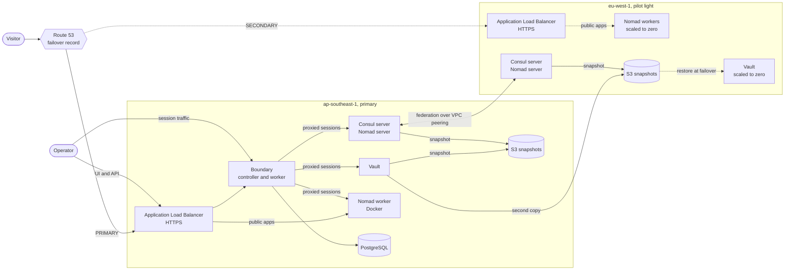

# The HashiCorp Stack


A self-hosted platform on AWS that spans two regions, built entirely from
HashiCorp's community editions. Consul handles service discovery, Nomad
schedules workloads, Vault holds secrets, and Boundary controls access. Packer
bakes the machine images. One Terraform root provisions both regions, and a
second root configures the services running on them.

The primary region runs the full platform. The second region is a pilot light.
One small server stays on and federated, a load balancer waits behind a
Route 53 failover record, and everything else is scaled to zero with its data
already replicated there. A pair of scripts moves the platform to the pilot
light and back.

## Architecture



| Node group | Runs | Primary | Pilot light |
|---|---|---|---|
| `nomad_consul_server` | Consul server, Nomad server | 1 | 1 |
| `vault` | Vault with integrated Raft storage, Consul client | 1 | 0, scaled up at failover |
| `nomad_worker` | Nomad client, Docker, Consul client | 1 | 0, up to 3 at failover |
| `boundary` | Boundary controller and worker, Consul client | 1 | not deployed yet |

Each group is an Auto Scaling group, sized for an account limited to 8 vCPU per
region. The modules accept 1, 3 or 5 servers per Raft group, and each group
takes its own instance type.

## Design principles

- **One way in.** Only Boundary and the public apps are published over HTTPS,
  to an allow-list of client addresses. Vault, Nomad, Consul and every host
  are reached through Boundary.
- **No SSH key pairs.** Instances launch without one. Hosts trust only
  short-lived certificates signed by Vault's SSH certificate authority, and
  Systems Manager is the break-glass path.
- **Immutable images.** Software is installed at image build time. Instances
  only receive configuration at boot, and changes roll out through a fresh
  `terraform apply`.
- **Discovery through Consul.** Nodes find their cluster by cloud auto-join
  tags and find services as `*.service.consul`, including across regions as
  `*.service.<datacenter>.consul`.
- **State outlives instances.** Vault, Consul and Nomad snapshot to S3 every
  10 minutes, and a replacement node restores the latest snapshot on first
  boot. Replacing a node is a routine operation.
- **No secrets in Terraform state.** The database password and the Vault and
  Boundary bootstrap credentials are generated outside state and kept in
  Secrets Manager. The configuration root reads Vault's root token as an
  ephemeral value.
- **One KMS key per purpose.** Vault's unseal key is multi-region, so a
  snapshot taken in one region unseals in the other.
- **Federated, not stretched.** Each region is its own Consul datacenter and
  Nomad region with its own Raft cluster. They share discovery and job
  submission, not state.
- **Nothing deployment-specific is hard-coded.** Regions, project name and
  apps come from Terraform variables, and the scripts take them as flags,
  environment variables or prompts.

## Prerequisites

| Requirement | Detail |
|---|---|
| Terraform | 1.11 or later |
| Packer | With the `amazon` plugin, `~> 1.8` |
| AWS CLI | A current version 2, plus the Session Manager plugin |
| Boundary CLI | Or the Boundary Desktop app, to open sessions |
| `jq` | Used by the scripts and the commands in this README |
| AWS profiles | `packer` for image builds and `terraform` for provisioning |
| Domain | A Route 53 public hosted zone that already exists |
| Quota | 8 on-demand vCPU in each region |

## 1. Build the images

There are four images, each built from Ubuntu 26.04 on amd64. Terraform
selects the newest image for each role by its `Role` tag, in whichever region
it is deploying to.

| Image | `Role` tag | Installed | Needed in |
|---|---|---|---|
| Control plane | `nomad-consul-control-plane` | Consul, Nomad | both regions |
| Worker | `nomad-consul-client-plane` | Consul, Nomad, Docker | both regions |
| Vault | `vault-control-plane` | Vault, Consul | both regions |
| Boundary | `boundary-plane` | Boundary, Consul, PostgreSQL client | primary |

Every image also carries:

- the AWS CLI and `jq`
- `.consul` DNS forwarding to the local Consul agent, through systemd-resolved
  (`DNS=127.0.0.1:8600`, `Domains=~consul`)
- trust for Vault's SSH certificate authority

Services are installed but left disabled, so nothing starts before its
configuration is written at boot.

From each image's directory:

```bash
packer init .
packer build .
```

`ami_regions` copies each finished image, with its tags, to `eu-west-1`. A
build launches a temporary instance, so it needs free vCPU quota in the
primary region.

```bash
# confirm what each region has
for r in ap-southeast-1 eu-west-1; do
  aws ec2 describe-images --region "$r" --owners self \
    --filters "Name=tag:BuiltBy,Values=packer" \
    --query 'sort_by(Images, &CreationDate)[].[Tags[?Key==`Role`]|[0].Value, ImageId, CreationDate]' \
    --output table
done
```

## 2. Provision both regions

Create `terraform.tfvars` in the Terraform root and keep it out of version
control.

```hcl
hashicorp_stack_domain = "example.com"
allowed_client_cidrs   = ["203.0.113.10/32"]

public_apps = {
  whoami = { port = 28080 }
}
```

```bash
terraform init
terraform apply
```

One apply builds both regions. Vault and Boundary initialize themselves on
first boot, so allow about five minutes before logging in.

### Variables

| Name | Default | Description |
|---|---|---|
| `region` | `ap-southeast-1` | Primary region. Also the Consul datacenter and Nomad region name. |
| `pilot_light_region` | `eu-west-1` | Pilot-light region, named the same way. |
| `hashicorp_stack_domain` | required | Public hosted zone. Boundary is published at `boundary.<domain>`. |
| `allowed_client_cidrs` | required | Addresses allowed to reach the load balancers and the Boundary worker. |
| `public_apps` | `{}` | Nomad workloads published on both load balancers, keyed by hostname, with Route 53 failover between the regions. Each needs a static host port in 20000–32000, plus an optional `health_path`. |

### Outputs

| Name | Description |
|---|---|
| `boundary_url` | Boundary's public URL |
| `public_app_urls` | URL per public app, served by whichever region is healthy |
| `vault_init_secret_arn`, `boundary_init_secret_arn` | Where the bootstrap credentials are kept |
| `autoscaling_group_names` | Auto Scaling groups in the primary |
| `pilot_light_autoscaling_group_names` | Auto Scaling groups in the pilot light |
| `iam_role_arns` | Instance role per node group |

### Modules

| Module | Purpose | Used in |
|---|---|---|
| `vpc` | Three-tier network across three zones, NAT gateway, private hosted zone | both regions |
| `vpc_peering` | Peering connection and routes between the two VPCs | once, spanning both |
| `kms` | One customer-managed key per purpose | primary, four keys |
| `kms_replica` | Replica of the multi-region Vault unseal key | pilot light |
| `rds` | PostgreSQL for Boundary, with the password kept out of state | primary |
| `s3` | Private, encrypted snapshot bucket with expiring history | both regions |
| `secrets` | Init secrets for Vault and Boundary; Vault's is replicated | primary |
| `alb` | Public load balancer, wildcard certificate, target groups and DNS records. Each service's `failover_role` makes its record a Route 53 `PRIMARY` or `SECONDARY` failover alias. | both regions |
| `ec2` | Node groups, IAM roles, first-boot init, snapshots and restore | both regions |

The second region is the same modules called again through a provider alias,
`aws.pilot_light`.

## 3. Configure Vault

The `config/` directory is a second Terraform root. It configures Vault
through its API, so it runs after the infrastructure root and needs a tunnel
to Vault. Today it creates Vault's SSH certificate authority, the
`host-access` role that issues five-minute certificates, and the policy
Boundary will use. Boundary's configuration comes next.

```bash
# terminal 1: tunnel to Vault, left running
aws ssm start-session --region "$PRIMARY_REGION" --target "$(node_id "$PRIMARY_REGION" vault)" \
  --document-name AWS-StartPortForwardingSession \
  --parameters '{"portNumber":["8200"],"localPortNumber":["8200"]}'

# terminal 2
cd config && terraform init
AWS_PROFILE=terraform terraform apply -var "project_name=$PROJECT" -var "region=$PRIMARY_REGION"
```

[config/README.md](config/README.md) covers why it is separate, the checks, how
SSH certificates work, and the Community Edition limit on credential
brokering.

## 4. Working with the platform

`scripts/helpers.sh` holds shell functions for everyday tasks. It contains no
deployment values. Set three variables, then source the file, in every new
terminal:

```bash
export PROJECT=hashicorp-stack PRIMARY_REGION=ap-southeast-1 PILOT_REGION=eu-west-1
source scripts/helpers.sh

export WHOAMI="$(terraform output -json public_app_urls | jq -r '.whoami')"
```

If any of the three is missing, the helpers refuse to run and say which one.
To avoid retyping, keep the exports in a git-ignored `.env` file and source it
before the helpers.

| Function | Does |
|---|---|
| `node_id <region> <role>` | Instance ID of the running node. Roles: `nomad_consul_server`, `nomad_worker`, `vault`, `boundary`. |
| `shell <region> <role>` | Opens a Systems Manager shell on that node |
| `asg <region> <role>` | Name of that role's Auto Scaling group |
| `bucket <region>` | Name of that region's snapshot bucket |
| `secret <vault\|boundary> [region]` | Prints an init secret as JSON; the region defaults to the primary |
| `replace <region> <role>` | Terminates the node; its group launches a new one |
| `alb_dns <region>` | DNS name of that region's load balancer |
| `tg_health <region> [prefix]` | Target health of a target group; the prefix defaults to `whoami` |

### Log in

```bash
secret boundary | jq '.auth_method'                 # auth_method_id, login_name, password
secret vault | jq -r '.root_token'                  # Vault root token
secret vault "$PILOT_REGION" | jq -r '.root_token'  # the same token, read from the replica

export BOUNDARY_ADDR="https://boundary.<domain>"
boundary authenticate password -auth-method-id <ampw_...> -login-name admin
```

Vault, Nomad and Consul are reached as Boundary TCP targets, addressed by their
Consul DNS names. For now, the targets are created by hand in Boundary's admin
UI and need recreating after a full rebuild. Step 4 part 2 moves them into
`config/`.

| Target | Address | Port | Local URL after `boundary connect` |
|---|---|---|---|
| Vault | `active.vault.service.consul` | 8200 | `http://127.0.0.1:8200` |
| Nomad | `http.nomad.service.consul` | 4646 | `http://127.0.0.1:4646` |
| Consul | `consul.service.consul` | 8500 | `http://127.0.0.1:8500` |

```bash
boundary targets list -recursive
boundary connect -target-id <ttcp_...>
```

### Verify a fresh build

```bash
shell $PRIMARY_REGION nomad_consul_server
```

```bash
sudo grep -E "snapshot yet|restored|WARNING|complete" /var/log/user-data.log
consul members                 # every node in this region, all alive
consul members -wan            # one server per region
nomad server members           # one server per region
nomad node status              # workers, ready
systemctl list-timers --all | grep -E "snapshot|fetch-ssh-ca"
```

On the Vault node (`shell $PRIMARY_REGION vault`):

```bash
export VAULT_ADDR=http://127.0.0.1:8200
vault status                                    # Initialized true, Sealed false
sudo journalctl -u vault-bootstrap --no-pager | grep "==>"
```

On the Boundary node (`shell $PRIMARY_REGION boundary`):

```bash
systemctl is-active boundary
curl -s -o /dev/null -w '%{http_code}\n' http://127.0.0.1:9203/health    # 200
```

### Deploy the test workload

`jobs/whoami.nomad.hcl` is the test app behind `public_apps`. It listens on
the same static host port in both regions and reports which region answered.

```hcl
job "whoami" {
  type = "service"

  group "web" {
    count = 1
    
    # 1. Give upstream load balancers time to stop sending traffic
    shutdown_delay = "30s"

    network {
      port "http" {
        static = 28080
        to     = 80
      }
    }

    service {
      name     = "whoami"
      port     = "http"
      provider = "consul"

      check {
        type     = "http"
        path     = "/"
        interval = "10s"
        timeout  = "2s"
      }
    }

    task "whoami" {
      driver = "docker"

      config {
        image = "traefik/whoami:v1.10"
        ports = ["http"]
        args  = ["--name", "${node.region}"]
      }

      resources {
        cpu    = 50
        memory = 32
      }
    }
  }
}
```

```bash
# through a Boundary session to Nomad, or on the server node
nomad job run jobs/whoami.nomad.hcl
nomad job status whoami
resolvectl query whoami.service.consul

# laptop
tg_health $PRIMARY_REGION             # healthy
curl -s "$WHOAMI" | grep Name         # Name: ap-southeast-1
```

To publish a real application, add it to `public_apps` and give its job the
same static port. No code changes are needed.

## 5. Snapshots and restore

| Service | Saved by | Key in the region's bucket | Restored when |
|---|---|---|---|
| Vault | `vault-snapshot.timer` on the active Vault node | `vault/latest.snap` | A new Vault node finds a snapshot and no running cluster |
| Consul | `server-snapshot.timer` on the Consul leader | `consul/latest.snap` | First boot of a single-server cluster |
| Nomad | `server-snapshot.timer` on the Nomad leader | `nomad/latest.snap` | First boot of a single-server cluster |

- Snapshots run 5 minutes after boot and every 10 minutes after that. Each run
  also writes a timestamped copy under `<service>/history/`, kept for 7 days.
- Vault's snapshots are written to both regions' buckets, so the pilot-light
  site always holds a recent copy. Consul and Nomad snapshots stay in their own
  region, because each region is a separate cluster.
- Vault's configuration, including the SSH CA from `config/`, is part of its
  snapshots.
- After a Vault restore, the original root token and recovery keys apply.
- If a restore fails, a marker file pauses that service's snapshots so an empty
  cluster can never overwrite a good snapshot.
- When a single node is replaced, anything written after the last snapshot is
  lost. That window is at most the snapshot interval.

```bash
# take snapshots now (on the node)
sudo systemctl start vault-snapshot      # Vault node
sudo systemctl start server-snapshot     # server node
sudo journalctl -u vault-snapshot --no-pager | tail -n 4
sudo journalctl -u server-snapshot --no-pager | tail -n 4

# what is stored (laptop)
aws s3 ls "s3://$(bucket $PRIMARY_REGION)/" --recursive --region $PRIMARY_REGION
aws s3 ls "s3://$(bucket $PILOT_REGION)/" --recursive --region $PILOT_REGION
```

Test a restore end to end:

```bash
# on the server node
consul kv put canary before-restore
sudo systemctl start server-snapshot

# laptop
replace $PRIMARY_REGION nomad_consul_server

# on the new server node, after about three minutes
sudo grep -E "restored|WARNING" /var/log/user-data.log
consul kv get canary
nomad job status
consul members
```

To start a service from nothing instead of restoring, empty its prefix first:

```bash
aws s3 rm "s3://$(bucket $PRIMARY_REGION)/consul/" --recursive --region $PRIMARY_REGION
```

## 6. The pilot-light region and federation

`eu-west-1` keeps one Consul and Nomad server and its load balancer running.
Its Vault and worker groups exist at zero instances, with their images, roles,
key replica and snapshots already in place.

```bash
shell $PILOT_REGION nomad_consul_server
```

```bash
consul members -wan
nomad server members
consul catalog services -datacenter=ap-southeast-1
resolvectl query vault.service.ap-southeast-1.consul
```

A job can be submitted to the pilot-light region from the primary with
`-region eu-west-1`, once a worker is running there. Its service then resolves
from the primary as `<service>.service.eu-west-1.consul`.

### DNS failover

Each public app has two Route 53 alias records with the same name: `PRIMARY`
pointing at the primary load balancer and `SECONDARY` at the pilot light's,
both with `evaluate_target_health`. When the primary's targets for that app are
all unhealthy, Route 53 answers with the pilot light. Once the primary is
healthy again, Route 53 moves back by itself.

- **Browsers hold connections open** across DNS changes. Test with `curl` or a
  new private window, not a tab that is already open.
- **A load balancer fails open.** If a target is registered but nothing
  answers on its port (for example, a worker running with no job), that region
  returns 502 until Route 53 notices the failed health checks. During failover,
  that 502 from the primary is expected.

```bash
dig +short "${WHOAMI#https://}"                     # which load balancer is answering
tg_health $PRIMARY_REGION; tg_health $PILOT_REGION
curl -s "$WHOAMI" | grep Name                       # which region served the request
```

## 7. Failover and failback

Both scripts take every value as a flag, an environment variable, or a prompt
when run in a terminal. Run either one with `--help` for its options. Each run
writes a timestamped log file, `failover-<time>.log` or `failback-<time>.log`,
in the current directory.

### Fail over

`scripts/failover.sh` talks only to the pilot-light region's APIs, plus one
brief, time-limited check of the primary, so it works when the primary is
down.

1. It refuses to start if the primary Vault still looks active (override with
   `--force`).
2. It scales up the pilot-light Vault and waits for it to restore from the
   replicated snapshot and unseal.
3. It scales up the workers and waits for them to join Nomad.
4. It submits the job files to the pilot-light region.
5. It waits for the load balancer targets, and optionally for the public URL.
6. It prints the recovery time and the age of the Vault data it restored.

```bash
./scripts/failover.sh \
  --project "$PROJECT" --primary-region "$PRIMARY_REGION" --pilot-region "$PILOT_REGION" \
  --workers 1 --job-file jobs/whoami.nomad.hcl --url "$WHOAMI"
```

| Flag | Environment | Default |
|---|---|---|
| `--project` | `PROJECT` | prompted |
| `--primary-region` | `PRIMARY_REGION` | prompted |
| `--pilot-region` | `PILOT_REGION` | prompted |
| `--workers` | `WORKERS` | `1` |
| `--job-file` (repeatable) | | none |
| `--url` | `APP_URL` | none |
| `--force`, `--yes` | | off |

### Fail back

`scripts/failback.sh` follows an order that keeps Vault to a single writer and
never sends traffic to a region that can't answer.

1. It stops any primary Vault that is still running, because that Vault holds
   data from before the failover.
2. It takes a fresh snapshot of the pilot-light Vault, stops it, and copies the
   snapshot into the primary bucket.
3. It starts the primary Vault, which restores that snapshot.
4. It starts the primary workers and jobs, and waits until the load balancer
   reports them healthy.
5. It stops the pilot-light jobs and scales the pilot light back to cold.

```bash
./scripts/failback.sh \
  --project "$PROJECT" --primary-region "$PRIMARY_REGION" --pilot-region "$PILOT_REGION" \
  --workers 1 --vault-nodes 1 --job-file jobs/whoami.nomad.hcl --url "$WHOAMI"
```

It takes the same flags as failover, without `--force`, plus these:

| Flag | Environment | Effect |
|---|---|---|
| `--vault-nodes` | `VAULT_NODES` | Primary Vault nodes to start: 1, 3 or 5 (default 1) |
| `--skip-vault-data` | | The primary restores from its own last snapshot, discarding writes made during the failover |
| `--keep-pilot-jobs` | | Leaves the pilot-light jobs registered |

When it finishes, run `terraform apply` in the infrastructure root so the
group sizes match the code again. The plan should show only those capacity
changes.

## 8. Command reference

Commands marked **laptop** use the helpers from section 4. The rest run on a
node.

### Nodes (laptop)

```bash
# every node in both regions
for r in $PRIMARY_REGION $PILOT_REGION; do
  aws ec2 describe-instances --region "$r" \
    --filters "Name=tag:Project,Values=$PROJECT" "Name=instance-state-name,Values=running" \
    --query 'Reservations[].Instances[].[Tags[?Key==`Role`]|[0].Value, InstanceId, PrivateIpAddress, InstanceType, LaunchTime]' \
    --output table
done

shell $PRIMARY_REGION vault                # open a shell on a node
replace $PRIMARY_REGION nomad_worker       # replace a node

# why a group is not launching
aws autoscaling describe-scaling-activities --region $PRIMARY_REGION \
  --auto-scaling-group-name "$(asg $PRIMARY_REGION vault)" --max-items 3 \
  --query 'Activities[].[StatusCode, StatusMessage]' --output text

# group sizes, for example after a failover
aws autoscaling describe-auto-scaling-groups --region $PILOT_REGION \
  --query "AutoScalingGroups[?starts_with(AutoScalingGroupName, '$PROJECT-')].[AutoScalingGroupName, MinSize, DesiredCapacity, MaxSize]" \
  --output table

# forward a port without Boundary, as a break-glass path
aws ssm start-session --region $PRIMARY_REGION --target "$(node_id $PRIMARY_REGION vault)" \
  --document-name AWS-StartPortForwardingSession \
  --parameters '{"portNumber":["8200"],"localPortNumber":["8200"]}'
```

### One command on every node (laptop)

```bash
for r in $PRIMARY_REGION $PILOT_REGION; do
  id=$(aws ssm send-command --region "$r" --document-name AWS-RunShellScript \
    --targets "Key=tag:Project,Values=$PROJECT" \
    --parameters 'commands=["cloud-init status; systemctl list-units --no-legend --plain consul.service nomad.service vault.service boundary.service"]' \
    --query Command.CommandId --output text)
  sleep 5
  aws ssm list-command-invocations --region "$r" --command-id "$id" --details \
    --query 'CommandInvocations[].[InstanceId, CommandPlugins[0].Output]' --output text
done
```

### Boot and service logs

```bash
cloud-init status                           # done = user data finished
sudo tail -n 30 /var/log/user-data.log      # ends with "user-data complete for <role>"

systemctl is-active consul nomad vault boundary
sudo journalctl -u <unit> --no-pager -n 40
sudo journalctl -fu <unit>
systemctl list-timers --all
```

| Unit | Found on | What it is |
|---|---|---|
| `consul` | every node | Consul agent |
| `nomad` | server, worker | Nomad agent |
| `vault` | vault | Vault server |
| `vault-bootstrap` | vault | One-time init, or restore from the latest snapshot |
| `vault-snapshot` | vault | Snapshot to S3, run by a timer |
| `server-snapshot` | server | Consul and Nomad snapshots to S3, run by a timer |
| `boundary` | boundary | Controller and worker |
| `boundary-bootstrap` | boundary | One-time database init |
| `fetch-ssh-ca` | every node | Fetches Vault's SSH CA public key, run by a timer |

### Consul

```bash
consul members                                      # this region
consul members -wan                                 # servers in both regions
consul catalog services
consul catalog services -datacenter=eu-west-1       # the other region's catalog
consul operator raft list-peers
consul kv put <key> <value> && consul kv get <key>

resolvectl query consul.service.consul
resolvectl query active.vault.service.consul
resolvectl query <service>.service.<datacenter>.consul

# health of a service, including in the other region
curl -s 'http://127.0.0.1:8500/v1/health/service/<service>?dc=<datacenter>' \
  | jq -r '.[] | "\(.Service.Address):\(.Service.Port)", (.Checks[] | "  \(.Name): \(.Status)")'
```

### Nomad

```bash
nomad server members                       # servers, leader and region
nomad node status                          # workers in this region
nomad node status -region eu-west-1        # workers in the other region
nomad node status -self | grep -i docker   # on a worker

nomad job run [-region <region>] <file>
nomad job status [-region <region>] <job>
nomad alloc status <alloc-id>
nomad alloc logs <alloc-id>
nomad job stop [-region <region>] <job>
```

### Vault

On the Vault node, or from a laptop with a Boundary session or tunnel open to
it:

```bash
export VAULT_ADDR=http://127.0.0.1:8200
export VAULT_TOKEN=<root token from `secret vault | jq -r .root_token`>

vault status
vault token lookup
vault operator raft list-peers
vault secrets list
vault auth list

vault policy read snapshot                 # what the node's snapshot login may do
vault read auth/aws/role/snapshot

vault read ssh/roles/host-access           # from config/
vault policy read boundary-controller      # from config/
curl -s $VAULT_ADDR/v1/ssh/public_key      # the CA the hosts trust
```

### Boundary

```bash
boundary auth-methods list                 # works before logging in
boundary authenticate password -auth-method-id <ampw_...> -login-name admin
boundary targets list -recursive
boundary connect -target-id <ttcp_...>
boundary sessions list -recursive

# laptop: is the public path working end to end?
curl -s -o /dev/null -w '%{http_code}\n' "$BOUNDARY_ADDR"
```

| Result | Meaning |
|---|---|
| 200 | DNS, certificate, load balancer and the service all working |
| 502 | A target is registered but nothing answers on its port |
| 503 | The load balancer is up but has no healthy targets |
| 404 | The hostname did not match a routing rule |
| Timeout | Your address is not in `allowed_client_cidrs` |

### Load balancers and DNS (laptop)

```bash
alb_dns $PRIMARY_REGION
tg_health $PRIMARY_REGION whoami

# ask one region's load balancer directly, bypassing failover DNS
curl -s -o /dev/null -w '%{http_code}\n' \
  --connect-to "${WHOAMI#https://}:443:$(alb_dns $PILOT_REGION):443" "$WHOAMI"

dig +short boundary.<domain>
dig +short NS <domain>
dig boundary.<domain> @<name server>       # ask Route 53 directly; read the status line
```

### Bootstrap lock (laptop)

```bash
# ids: vault-init, vault-restore, boundary-db-init
aws dynamodb get-item --region $PRIMARY_REGION --table-name $PROJECT-bootstrap-lock \
  --key '{"LockId":{"S":"vault-init"}}'

aws dynamodb delete-item --region $PRIMARY_REGION --table-name $PROJECT-bootstrap-lock \
  --key '{"LockId":{"S":"vault-init"}}'
```

## Operations

**Rolling out a change.** Templates and images take effect when a node boots.
This project rolls changes out with a fresh `terraform apply`, not by patching
running nodes. Vault configuration changes go through the `config/` root.

**Replacing one node.** This is safe for every role. Vault, Consul and Nomad
restore from their snapshots, Boundary resumes against its database, and a
worker's jobs are rescheduled. Take a snapshot first if recent writes matter.

**Failing over.** Run `scripts/failover.sh`. While failed over, don't apply
the infrastructure root without reading its plan first, because it would put
the group sizes back to the values in code. After `scripts/failback.sh`
finishes, that apply is exactly what is needed.

**Rebuilding from nothing.** `terraform destroy` removes both regions,
including the snapshot buckets, the init secrets and the database. The next
apply is a new platform with new credentials. Delete `config/terraform.tfstate`
before applying `config/` again, and recreate the Boundary targets. KMS keys
enter a 30-day deletion window.

**Changing a node's size.** Set `instance_type` per group through the `ec2`
module's `node_groups` input. Every `t3` size up to `large` counts as 2 vCPU.

## Status

Working today:

- Both regions built by one `terraform apply`
- All four services running, joined and initialized without manual steps
- Boundary published over HTTPS, with Vault, Nomad and Consul reachable only
  through it
- Vault, Consul and Nomad state restored automatically after a node is replaced
- Consul and Nomad federated across the regions: a job submitted through the
  primary ran in `eu-west-1`, and its service resolved by name from the primary
- Vault restored in `eu-west-1` from the replicated snapshot, unsealed with the
  replica key, and readable with the original root token
- Public apps on both load balancers behind a Route 53 failover record
- Scripted failover to the pilot-light region and failback with Vault's data,
  both exercised in drills

In progress:

- Step 4, part 1: Vault's SSH certificate authority, issuing role and
  Boundary policy as code, in `config/`

Planned next, in order:

1. The rest of step 4. Boundary configured as code: scopes, a Vault credential
   store, an AWS host catalog, SSH targets with certificates brokered from
   Vault, and the Vault, Nomad and Consul targets. Then dynamic database
   credentials.
2. Hardening: gossip encryption keys for Consul and Nomad, then ACLs and TLS,
   a KMS keyring for Nomad, a non-root admin login for `config/`, and pinned
   product versions in the images
3. A Network Load Balancer for internal traffic, Boundary in the pilot-light
   region, and three nodes per Raft group when quota allows

## Known limitations

- Single nodes throughout, so there is no high availability yet.
- Consul and Nomad run without ACLs or encryption; Boundary is the only control
  in front of them.
- Automatic restore of Consul and Nomad applies to single-server clusters only.
- Boundary exists only in the primary region, and its targets are configured by
  hand until step 4 part 2. After a failover, the platform is administered
  through Systems Manager until Boundary runs in the pilot light.
- Boundary Community Edition cannot inject SSH certificates. They will be
  brokered as JSON and used through a helper script instead.
- The `config/` root authenticates to Vault with the root token, read
  ephemerally and never stored in state.
- The pilot-light Vault must not run while the primary Vault is active. The
  failover script checks for this.
- DNS failover depends on Route 53 health evaluation and on clients resolving
  again. Open browser connections keep reaching the old region.
- Nomad's snapshots contain its encryption keys, so the snapshot buckets are
  sensitive.
- The Consul server config carries a workaround for a regression in Consul
  2.0.4 (hashicorp/consul#23923), `limits { rpc_handshake_timeout = "0s" }`,
  until the images pin an unaffected version.
- No timed game day has been run, so recovery time, data loss and the cost
  ratio are design targets, not measurements. The failover and failback
  scripts have been exercised in drills. Data loss is bounded by design to the
  10-minute snapshot interval.