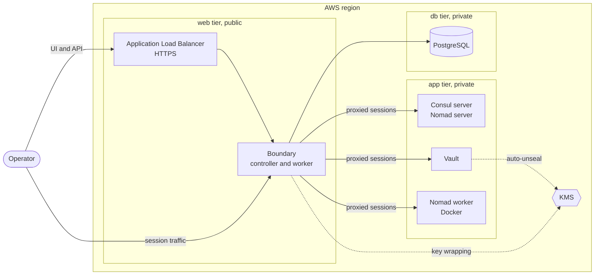

# The HashiCorp Stack


A self-hosted platform on AWS built entirely from HashiCorp's community
editions: Consul for service discovery, Nomad for workload scheduling, Vault for
secrets, and Boundary for access. Packer bakes the machine images and Terraform
provisions everything else.

The whole platform has one public entry point. Boundary is the only service
reachable from outside; Vault, Nomad, Consul and every host are reached through
an authenticated Boundary session.

## Architecture



| Node group | Runs | Tier | Nodes today |
|---|---|---|---|
| `nomad_consul_server` | Consul server, Nomad server | app | 1 |
| `vault` | Vault with integrated Raft storage, Consul client | app | 1 |
| `nomad_worker` | Nomad client, Docker, Consul client | app | 1 |
| `boundary` | Boundary controller and worker, Consul client | web | 1 |

Each group is an Auto Scaling group, sized for an account limited to 8 vCPU.
The modules accept 1, 3 or 5 servers per Raft group, so scaling up is a change
of numbers, not of design.

## Design principles

- **One way in.** Only Boundary is published, over HTTPS, to an allow-list of
  client addresses.
- **No SSH key pairs.** Instances launch without one, and port 22 accepts
  connections only from the Boundary worker. Systems Manager is the break-glass
  path.
- **Immutable images.** Software is installed at image build time. Instances
  only receive configuration at boot and never install packages.
- **Discovery through Consul.** Nodes find their cluster by cloud auto-join tags
  and find each other's services as `*.service.consul`. There is no internal
  load balancer.
- **No secrets in Terraform state.** The database password and the Vault and
  Boundary bootstrap credentials are generated outside state and stored in
  Secrets Manager.
- **One KMS key per purpose.** Vault's seal and Boundary's three key roles each
  have their own key.

## Prerequisites

| Requirement | Detail |
|---|---|
| Terraform | 1.11 or later |
| Packer | With the `amazon` plugin, `~> 1.8` |
| AWS CLI | Version 2, plus the Session Manager plugin |
| Boundary CLI | Or the Boundary Desktop app, to open sessions |
| AWS profiles | `packer` for image builds and `terraform` for provisioning |
| Domain | A Route 53 public hosted zone that already exists |
| Quota | 8 on-demand vCPU in the region; the four nodes use all of it |

## 1. Build the images

Four images, each from Ubuntu 26.04 on amd64. Terraform selects the newest
available image for each role by its `Role` tag.

| Image | `Role` tag | Installed |
|---|---|---|
| Control plane | `nomad-consul-control-plane` | Consul, Nomad |
| Worker | `nomad-consul-client-plane` | Consul, Nomad, Docker |
| Vault | `vault-control-plane` | Vault, Consul |
| Boundary | `boundary-plane` | Boundary, Consul, PostgreSQL client |

Every image also carries the AWS CLI and `jq`, `.consul` DNS forwarding to the
local Consul agent, and trust for Vault's SSH certificate authority. Services
are installed but left disabled, so nothing starts before its configuration is
written at boot.

From each image's directory:

```bash
packer init .
packer build .
```

A build launches a temporary instance, so it needs free vCPU quota. Build the
images before the first `terraform apply`, or after removing the Auto Scaling
groups (see Operations).

## 2. Provision the platform

Create `terraform.tfvars` in the Terraform root.