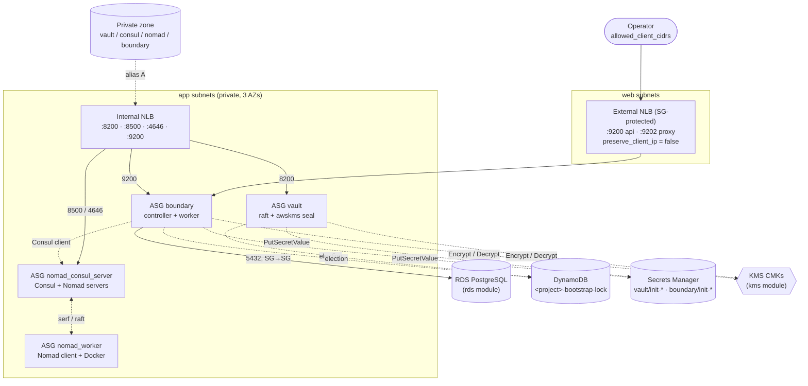
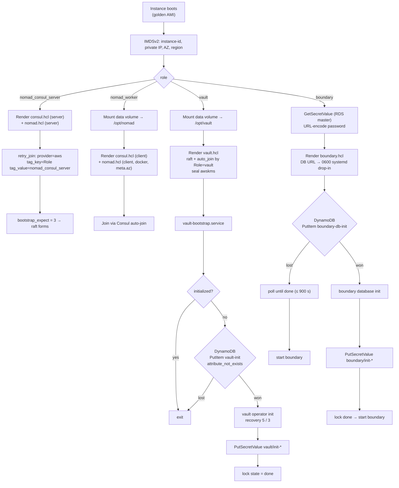

# `ec2` — HashiCorp Control & Data Plane Compute


This module is the compute layer of the platform. From the golden AMIs baked by [Packer](../../../packer), it builds **four role-specific Auto Scaling groups**: Consul/Nomad servers, Nomad clients, Vault and Boundary. It fronts them with an **internal NLB** (service plane) and an **allow-listed external NLB** (Boundary ingress only). It also gives each role a **least-privilege IAM identity** and runs a **self-orchestrating cold start**, in which clusters form, initialise and publish their bootstrap material without an operator.

> Back to the [platform README](../../../README.md).

---

## Contents

- [Architecture](#architecture)
- [Node Groups](#node-groups)
- [Cold-Start Orchestration](#cold-start-orchestration)
- [Usage](#usage)
- [Inputs](#inputs)
- [Outputs](#outputs)
- [Networking & Security Groups](#networking--security-groups)
- [IAM Model](#iam-model)
- [Design Decisions](#design-decisions)
- [Operations](#operations)
- [Known Limitations](#known-limitations)

---

## Architecture



**Resources created**

| Kind | Count | Notes |
| :-- | :-- | :-- |
| `aws_autoscaling_group` / `aws_launch_template` | 1 per node group | `create_before_destroy`, `desired_capacity` ignored after create |
| `aws_security_group` | 1 per node group + 1 for the external NLB | Rules are separate `aws_vpc_security_group_*_rule` resources |
| `aws_iam_role` / `aws_iam_instance_profile` | 1 per node group | Inline policies are attached per role |
| `aws_lb` | 2 | `int-*` (internal), `ext-*` (internet-facing) |
| `aws_lb_target_group` / `aws_lb_listener` | 4 internal + 2 external | TCP, instance targets, TCP health checks |
| `aws_route53_record` | 4 | `<service>.<private_zone_name>` → internal NLB alias |
| `aws_dynamodb_table` | 1 | Only when `enable_bootstrap_automation` |
| `aws_secretsmanager_secret` | 2 | Only when `enable_bootstrap_automation`; values are written by instances |

---

## Node Groups

`node_groups` is a map whose keys are fixed: `nomad_consul_server`, `nomad_worker`, `boundary` and `vault`. Each key selects an AMI, an IAM policy set, security group ports, NLB target groups and the user-data branch.

| Group | AMI `Role` tag | Platform sizing | Data volume | Load balancer | Runs |
| :-- | :-- | :-- | :-- | :-- | :-- |
| `nomad_consul_server` | `nomad-consul-control-plane` | 3 / 3 / 5 | — | internal `:8500`, `:4646` | Consul server, Nomad server (`bootstrap_expect = 3`) |
| `nomad_worker` | `nomad-consul-client-plane` | 2 / 2 / 4 | optional → `/opt/nomad` | — | Consul client, Nomad client, Docker |
| `vault` | `vault-control-plane` | 3 / 3 / 5 | **required** → `/opt/vault` | internal `:8200` | Vault, integrated raft, KMS auto-unseal |
| `boundary` | `boundary-plane` | 2 / 2 / 4 | — | internal `:9200`; **external `:9200`, `:9202`** | Boundary controller + worker, Consul client |

*Sizing is min / desired / max.*

**Per-group knobs** (all optional):

| Field | Default | Notes |
| :-- | :-- | :-- |
| `instance_type` | `t3.micro` | Evaluation size. Vault and servers want ≥ `t3.medium` in production. |
| `min_size` / `desired_capacity` / `max_size` | `3` / `3` / `5` | Validated: raft groups need `min_size >= 3`, and desired must sit between min and max. |
| `root_volume_size` / `root_volume_type` | `10` / `gp3` | Always encrypted. |
| `data_volume_size` / `_type` / `_iops` | `null` / `gp3` / `null` | Attached as `/dev/sdf`. User-data finds the first unmounted disk (Nitro renames to NVMe), formats it `ext4 LABEL=data` and mounts it. |
| `spot_enabled` / `spot_max_price` / `on_demand_base_count` | `false` / `null` / `0` | Switches to a `mixed_instances_policy` with `price-capacity-optimized`. **Rejected for `vault` and `nomad_consul_server`.** |
| `health_check_type` / `health_check_grace_period` | `EC2` / `300` | |
| `detailed_monitoring` | `false` | 1-minute CloudWatch metrics. |
| `extra_user_data` | `""` | Appended at the end of the rendered user-data. |
| `extra_tags` | `{}` | Merged onto instances. |

---

## Cold-Start Orchestration

Everything below happens in [`templates/user_data.sh.tftpl`](templates/user_data.sh.tftpl) on first boot. No binaries are installed at boot; the AMI already contains them.



The election uses the same conditional-write technique as Terraform's S3/DynamoDB state lock. `PutItem` with `attribute_not_exists(LockId)` succeeds for exactly one caller, so there is exactly one `vault operator init` and exactly one schema migration, however many nodes boot in parallel.

---

## Usage

As used in [`terraform/main.tf`](../../main.tf):

```hcl
module "ec2" {
  source       = "./modules/ec2"
  project_name = "hashicorp-stack"
  region       = var.region

  vpc_id             = module.networking.vpc-id
  vpc_cidr           = module.networking.vpc-cidr_block
  public_subnet_ids  = module.networking.web_subnet_ids
  private_subnet_ids = module.networking.app_subnet_ids
  private_zone_id    = module.networking.zone_id
  private_zone_name  = module.networking.zone_name

  kms_key_arns = {
    vault_unseal         = module.kms_vault_unseal.key_arn
    boundary_root        = module.kms_boundary_root.key_arn
    boundary_worker_auth = module.kms_boundary_worker.key_arn
    boundary_recovery    = module.kms_boundary_recovery.key_arn
  }

  boundary_db = {
    host       = module.rds.address
    port       = module.rds.port
    dbname     = module.rds.dbname
    secret_arn = module.rds.master_user_secret_arn
  }
  boundary_db_security_group_id = module.rds.security_group_id

  allowed_client_cidrs = var.allowed_client_cidrs   # e.g. ["203.0.113.7/32"]

  node_groups = {
    nomad_consul_server = {}
    nomad_worker        = { min_size = 2, max_size = 4, desired_capacity = 2 }
    boundary            = { min_size = 2, max_size = 4, desired_capacity = 2 }
    vault               = { data_volume_size = 10 }
  }
}
```

A production-leaning `node_groups`:

```hcl
node_groups = {
  nomad_consul_server = { instance_type = "m6i.large" }
  vault               = { instance_type = "m6i.large", data_volume_size = 50, data_volume_iops = 3000 }
  boundary            = { instance_type = "t3.medium", min_size = 2, desired_capacity = 2, max_size = 4 }
  nomad_worker = {
    instance_type        = "m6i.xlarge"
    min_size             = 3
    desired_capacity     = 3
    max_size             = 12
    data_volume_size     = 100
    spot_enabled         = true
    on_demand_base_count = 2        # keep a stable floor on-demand
  }
}
```

---

## Inputs

### Required

| Name | Type | Description |
| :-- | :-- | :-- |
| `project_name` | `string` | Prefix for names and the `Project` tag. Also the Vault `cluster_name`. |
| `region` | `string` | Region for the AMI lookup. |
| `vpc_id` | `string` | Target VPC. |
| `vpc_cidr` | `string` | Source CIDR for intra-cluster SG rules. |
| `public_subnet_ids` | `list(string)` | Web tier, used only by the external NLB. Validated to at least 2. |
| `private_subnet_ids` | `list(string)` | App tier: all ASGs and the internal NLB. Validated to at least 3, for raft across three AZs. |
| `private_zone_id` / `private_zone_name` | `string` | From the `vpc` module. |
| `kms_key_arns` | `object` | `vault_unseal`, `boundary_root`, `boundary_worker_auth`, `boundary_recovery`, and optional `ebs`. |
| `boundary_db` | `object` | `{ host, port, dbname, secret_arn }`. No password, by design. |
| `allowed_client_cidrs` | `list(string)` | CIDRs allowed to reach the external NLB. **No default on purpose**: an empty or `0.0.0.0/0` value is a deliberate decision. |

### Optional

| Name | Default | Description |
| :-- | :-- | :-- |
| `node_groups` | see [Node Groups](#node-groups) | Per-role sizing, disks, spot and health checks. |
| `service_hostnames` | `vault` / `consul` / `nomad` / `boundary` | Record names in the private zone. **They end up in TLS SANs**, so treat them as permanent. |
| `ami_owners` | `["self"]` | Accounts that own the Packer AMIs. Use this for a central image-factory account. |
| `ami_role_tags` | see Node Groups | `Role` tag values that Packer stamps on each AMI. |
| `consul_datacenter` | `"dc1"` | Consul datacenter and Nomad datacenter name. Use a distinct name per region for federation. |
| `bootstrap_expect` | `3` | Must equal the `nomad_consul_server` desired capacity. |
| `retry_join_tag_key` | `"ConsulAutoJoin"` | Tag applied to instances. See Known Limitations. |
| `enable_bootstrap_automation` | `true` | DynamoDB election plus automatic `vault operator init` and `boundary database init`. Turn it off to hold the recovery keys yourself. |
| `instance_refresh_enabled` | `false` | Roll ASGs automatically on launch-template change (`min_healthy_percentage = 66`). Keep this off for raft groups until you trust the path. |
| `boundary_db_security_group_id` | `null` | RDS SG that receives the Boundary → 5432 rule. |
| `create_rds_ingress_rule` | `true` | Separate flag, because `count` cannot depend on an unknown ID. |
| `boundary_db_kms_key_id` | `null` | Adds `kms:Decrypt` for the Boundary role when the RDS secret uses a CMK. |
| `enable_cross_zone_load_balancing` | `true` | On both NLBs. |
| `enable_deletion_protection` | `false` | On both NLBs. |
| `nlb_access_logs` | `{}` | `{ enabled, bucket, prefix }`. `bucket` is required when enabled. |
| `target_group_deregistration_delay` | `60` | Seconds. Keep this above the Boundary session grace period. |
| `enable_ssm` | `true` | Attaches `AmazonSSMManagedInstanceCore`, the break-glass shell. |
| `key_name` | `null` | EC2 key pair. `null` means no SSH keys. |
| `additional_security_group_ids` | `{}` | Extra SGs per node group. |
| `enable_imdsv2_only` | `true` | `http_tokens = required`, hop limit 2 (so containers on workers can still reach IMDS). |
| `tags` | `{}` | Merged onto everything. |

## Outputs

| Name | Description |
| :-- | :-- |
| `external_nlb_dns_name` | Boundary's public address (`BOUNDARY_ADDR=http://<this>:9200`). Also the workers' `public_addr`. |
| `external_nlb_zone_id` / `external_nlb_arn` | For a public alias record, or for WAF and Shield association. |
| `internal_nlb_dns_name` / `internal_nlb_zone_id` / `internal_nlb_arn` | Prefer `service_fqdns` over these. |
| `service_fqdns` | `{ vault, consul, nomad, boundary }` → private FQDN. |
| `service_endpoints` | Scheme + host + port per service. **Switches to `https` once TLS lands**, so downstream consumers should read from here. |
| `vault_addr` | Convenience value for `VAULT_ADDR`. |
| `security_group_ids` | Per node group. Use these as SG-to-SG sources in other modules. |
| `external_nlb_security_group_id` | The external NLB's SG. |
| `autoscaling_group_names` / `autoscaling_group_arns` | For instance refresh, scaling policies and EventBridge rules. |
| `launch_template_ids` | Per node group. |
| `iam_role_names` / `iam_role_arns` | Attach extra policies, or bind them to Vault's AWS auth method. |
| `ami_ids` | The AMI that `most_recent` actually resolved for each group in this apply. |
| `target_group_arns` | Prefixed `internal_` / `external_`. |
| `vault_init_secret_arn` / `boundary_init_secret_arn` | Where the bootstrap material lands. |

---

## Networking & Security Groups

**Ports are constants.** They are properties of the products, so they live in `locals.ports` and are not exposed as inputs.

| Group | TCP ingress (from `vpc_cidr`) | UDP ingress (from `vpc_cidr`) |
| :-- | :-- | :-- |
| `nomad_consul_server` | 8300, 8301, 8302, 8500, 8501, 8502, 8600, 4646, 4647, 4648 | 8301, 8302, 8600, 4648 |
| `nomad_worker` | 8301, 8302, 8500, 8600, 4646, 4647, 4648 | 8301, 8302, 8600, 4648 |
| `boundary` | 9200, 9201, 9202, 8301, 8500 | 8301 |
| `vault` | 8200, 8201 | — |

- **Egress:** all groups allow all egress (package mirrors, AWS APIs through NAT, workload traffic).
- **External NLB SG:** ingress on 9200 and 9202 from each `allowed_client_cidrs` entry only. Egress goes only to the Boundary SG.
- **RDS:** a single SG-to-SG rule, Boundary → 5432, created on the RDS module's SG.
- **Client IP preservation is disabled** on the external target groups. Boundary instances see the NLB's address, not the client's, so client allow-listing is enforced **at the NLB SG**, not on the instances.

---

## IAM Model

Every role gets only what its user-data actually calls.

| Policy | `nomad_consul_server` | `nomad_worker` | `vault` | `boundary` |
| :-- | :-: | :-: | :-: | :-: |
| `autojoin`: `ec2:DescribeInstances`, `autoscaling:DescribeAutoScalingGroups` | ✅ | ✅ | ✅ | ✅ |
| `AmazonSSMManagedInstanceCore` (if `enable_ssm`) | ✅ | ✅ | ✅ | ✅ |
| `kms:Encrypt/Decrypt/DescribeKey/GenerateDataKey` on `vault-unseal` | | | ✅ | |
| `kms:Encrypt/Decrypt/DescribeKey/GenerateDataKey` on the 3 Boundary keys | | | | ✅ |
| `secretsmanager:GetSecretValue` on the **RDS master secret ARN only** | | | | ✅ |
| `dynamodb:PutItem/GetItem/UpdateItem` on the lock table | | | ✅ | ✅ |
| `secretsmanager:PutSecretValue` on its **own** init secret only | | | ✅ | ✅ |

Nomad workers have no KMS or Secrets Manager access at all. Workload secrets are meant to come from Vault, not from the instance role.

---

## Design Decisions

**AMIs resolved by tag, not name.** `data.aws_ami` filters on `Role` + `BuiltBy=packer` with `most_recent = true`. A new Packer bake is picked up on the next plan (visible in the `ami_ids` output) without changing any code, and renaming images never breaks the lookup.

**`ignore_changes = [desired_capacity]`.** After creation, capacity belongs to operators, scaling policies and DR failover. A routine `terraform apply` will not undo a scale-out.

**`create_before_destroy` on launch templates, SGs, target groups and instance profiles.** This allows replacement without an outage window, and it is why names use `name_prefix` instead of `name`.

**Controller and worker co-located.** Each Boundary instance runs both, with the worker's upstream at `127.0.0.1:9201`. This halves the fleet at small scale. Split them once session throughput, or network isolation between controllers and targets, requires it.

**The DB password never lands in a config file.** Boundary reads `env://BOUNDARY_PG_URL` from a `0600` systemd drop-in. `boundary.hcl` itself is `0640` and contains no secrets.

**Raft groups are protected by validation, not by convention.** Spot capacity, fewer than 3 nodes, and Vault without a data volume are all rejected at plan time.

---

## Operations

```bash
# Where things are
terraform -chdir=terraform output service_endpoints
terraform -chdir=terraform output ec2_ami_ids

# Shell without SSH
aws ssm start-session --target <instance-id>
sudo tail -f /var/log/user-data.log
systemctl status consul nomad vault boundary vault-bootstrap boundary-bootstrap

# Bootstrap state
aws dynamodb scan --table-name hashicorp-stack-bootstrap-lock \
  --query 'Items[].{lock:LockId.S,state:state.S,holder:holder.S}' --output table
```

**Rolling a new AMI into a raft group.** Roll one node at a time:

```bash
ASG=$(aws autoscaling describe-auto-scaling-groups \
  --query "AutoScalingGroups[?starts_with(AutoScalingGroupName,'hashicorp-stack-vault-')].AutoScalingGroupName" \
  --output text)
aws autoscaling start-instance-refresh --auto-scaling-group-name "$ASG" \
  --preferences '{"MinHealthyPercentage":66,"InstanceWarmup":300}'
# Between replacements:
vault operator raft list-peers        # 3 voters, 1 leader
vault operator raft autopilot state   # Healthy: true
```

**Re-running bootstrap** (for example, after wiping a test environment without destroying the table): delete the `vault-init` / `boundary-db-init` items from the lock table before the new nodes boot.

---

## Known Limitations

| Item | Impact | Suggested fix |
| :-- | :-- | :-- |
| TLS disabled everywhere | Vault, Boundary and Consul listeners use `tls_disable = true`. There is no Consul gossip encryption and no ACLs. The external NLB forwards plaintext Boundary traffic. | Issue certificates from Vault PKI (platform roadmap, milestone 1). Keep `allowed_client_cidrs` tight until then. |
| `retry_join_tag_key` unused for joining | The `ConsulAutoJoin=<project>` tag is applied, but every `retry_join` / `auto_join` filters on `Role=<group>`. Two stacks with the same group names in one account and region would cross-join. | Filter on `tag_key=${retry_join_tag_key} tag_value=${project_name}` plus the role. |
| TCP-only health checks | A sealed or uninitialised Vault node, or a Nomad server without a leader, still passes and receives traffic. | Use an HTTP health check on `/v1/sys/health?standbyok=true` for Vault, `/v1/status/leader` for Consul and Nomad, and `/health` on Boundary ops. |
| `health_check_type = "EC2"` | The ASG doesn't replace instances that fail NLB health checks. | Use `ELB` for NLB-attached groups once the HTTP health checks exist. |
| Intra-cluster rules sourced from `vpc_cidr` | Anything in the VPC, including other tiers, can reach raft and RPC ports. | Switch to SG-to-SG references between node groups. |
| Vault `disable_mlock = false` with raft | HashiCorp recommends `disable_mlock = true` with integrated storage, to avoid memory-mapped raft files being locked into RAM. | Set `disable_mlock = true` and disable swap in the AMI instead. |
| Single datacenter name | `consul_datacenter = "dc1"` is used for both Consul and Nomad. A second region needs a distinct name before federation. | Set it per environment (for example `apse1`, `dr-apse2`). |
