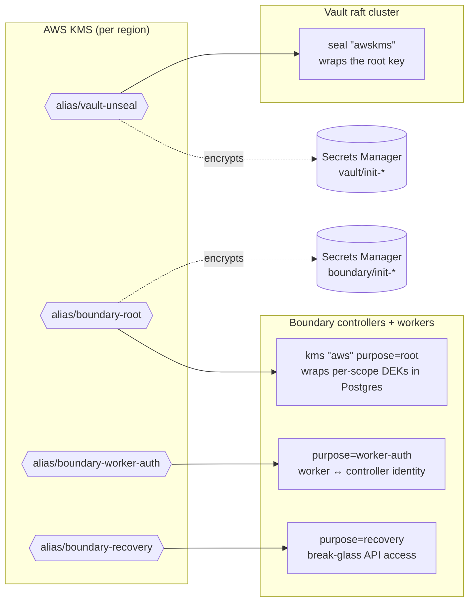

# `kms` — Purpose-Scoped Customer-Managed Keys


This is a deliberately small module: **one symmetric customer-managed key (CMK) plus one alias per instantiation**. The platform calls it once for each cryptographic purpose instead of sharing a single key. Each key's blast radius, audit trail (CloudTrail `kms:*` events) and IAM grants therefore stay independent.

> Back to the [platform README](../../../README.md).

---

## Contents

- [Key Hierarchy in This Platform](#key-hierarchy-in-this-platform)
- [Usage](#usage)
- [Inputs](#inputs)
- [Outputs](#outputs)
- [Design Decisions](#design-decisions)
- [Key Policy](#key-policy)
- [Multi-Region / DR Considerations](#multi-region--dr-considerations)
- [Operations](#operations)
- [Known Limitations](#known-limitations)

---

## Key Hierarchy in This Platform



| Alias | Consumer | What it protects | If lost or disabled |
| :-- | :-- | :-- | :-- |
| `vault-unseal` | Vault `seal "awskms"`, `vault/init-*` secret | Vault's root key, and so every secret in Vault. Also the bootstrap recovery keys and root token. | Vault **cannot unseal**. Data is unrecoverable without the key. |
| `boundary-root` | Boundary controllers, `boundary/init-*` secret | Per-scope data-encryption keys that wrap credentials, host-catalog secrets and session data stored in Postgres. | Boundary **cannot decrypt its database**. |
| `boundary-worker-auth` | Boundary controllers + workers | Worker registration and authentication to controllers. | Workers cannot join. Sessions fail. |
| `boundary-recovery` | Operators (break-glass) | Recovery-mode API access when the auth method or admin credentials are broken. | No break-glass path. Normal operation is unaffected. |

---

## Usage

As used in [`terraform/main.tf`](../../main.tf):

```hcl
module "kms_vault_unseal" {
  source       = "./modules/kms"
  project_name = "hashicorp-stack"
  alias        = "vault-unseal"
}

module "kms_boundary_root" {
  source       = "./modules/kms"
  project_name = "hashicorp-stack"
  alias        = "boundary-root"
}

# ...boundary-worker-auth, boundary-recovery

module "ec2" {
  # ...
  kms_key_arns = {
    vault_unseal         = module.kms_vault_unseal.key_arn
    boundary_root        = module.kms_boundary_root.key_arn
    boundary_worker_auth = module.kms_boundary_worker.key_arn
    boundary_recovery    = module.kms_boundary_recovery.key_arn
  }
}
```

With an explicit description and a least-privilege key policy (see [Key Policy](#key-policy)):

```hcl
module "kms_vault_unseal" {
  source       = "./modules/kms"
  project_name = "hashicorp-stack"
  alias        = "hashicorp-stack/vault-unseal"   # namespaced alias
  description  = "Vault awskms auto-unseal for hashicorp-stack"
  policy       = data.aws_iam_policy_document.vault_unseal_key.json
}
```

---

## Inputs

| Name | Type | Default | Description |
| :-- | :-- | :-- | :-- |
| `project_name` | `string` | — **(required)** | Applied as the `Project` tag. |
| `alias` | `string` | — **(required)** | Alias without the `alias/` prefix. Must be unique per account and region. Validated against `^[a-zA-Z0-9/_-]+$`. |
| `description` | `string` | `null` | Key description shown in the console and in CloudTrail. |
| `deletion_window_in_days` | `number` | `30` | Waiting period after `ScheduleKeyDeletion` (7–30, validated). Keep this at 30 for keys that protect data. |
| `enable_key_rotation` | `bool` | `true` | Annual automatic rotation of the key material. |
| `policy` | `string` | `null` | JSON key policy. `null` applies the AWS default policy (see below). |
| `tags` | `map(string)` | `{}` | Merged with `Project` and `Alias` tags. |

## Outputs

| Name | Description |
| :-- | :-- |
| `key_id` | Key UUID. |
| `key_arn` | Key ARN. Pass this to Vault/Boundary config and IAM policies. |
| `alias_name` | `alias/<alias>`. |
| `alias_arn` | Alias ARN. |

---

## Design Decisions

**One key per purpose, not one key per platform.**
Boundary requires distinct `root`, `worker-auth` and `recovery` keys. The separation matters beyond compliance: the recovery key can be locked down to a break-glass role, and revoking a compromised worker-auth key does not touch the encrypted database.

**Rotation on by default.**
KMS rotation keeps every prior version of the key material, so ciphertext wrapped before a rotation still decrypts. It is transparent to both Vault auto-unseal and Boundary. No re-wrap or restart is required.

**30-day deletion window.**
Deleting the `vault-unseal` or `boundary-root` key makes Vault or Boundary data **permanently** unrecoverable. The maximum window gives the most time to notice and run `CancelKeyDeletion`.

**Aliases as the stable handle.**
Humans and runbooks refer to `alias/vault-unseal`. Terraform wires ARNs. If a key ever has to be replaced, the alias is re-pointed and the ARN change flows through one apply.

---

## Key Policy

When `policy = null`, AWS applies its default key policy. That policy grants the account root principal `kms:*`, which **delegates access control to IAM**. This platform relies on that delegation: the `ec2` module grants each instance role only the actions it needs on only the keys it needs.

| Role | Keys | Actions |
| :-- | :-- | :-- |
| `vault` | `vault-unseal` | `kms:Encrypt`, `kms:Decrypt`, `kms:DescribeKey`, `kms:GenerateDataKey` |
| `boundary` | `boundary-root`, `boundary-worker-auth`, `boundary-recovery` | `kms:Encrypt`, `kms:Decrypt`, `kms:DescribeKey`, `kms:GenerateDataKey` |

`Encrypt` and `Decrypt` serve Vault's `awskms` seal and Boundary's KMS wrappers, which call KMS directly. `GenerateDataKey` is needed because the bootstrap init secrets are encrypted under these CMKs. Secrets Manager uses envelope encryption, and on `PutSecretValue` it calls `kms:GenerateDataKey` with the caller's credentials.

For production, consider a **key-policy-enforced** model, so that no IAM administrator can grant themselves use of the key:

```hcl
data "aws_iam_policy_document" "vault_unseal_key" {
  statement {
    sid       = "KeyAdministration"
    actions   = ["kms:Create*", "kms:Describe*", "kms:Enable*", "kms:List*", "kms:Put*",
                 "kms:Update*", "kms:Revoke*", "kms:Disable*", "kms:Get*", "kms:Delete*",
                 "kms:TagResource", "kms:UntagResource", "kms:ScheduleKeyDeletion",
                 "kms:CancelKeyDeletion"]
    resources = ["*"]
    principals { type = "AWS", identifiers = [var.platform_admin_role_arn] }
  }

  statement {
    sid       = "VaultUnsealUse"
    actions   = ["kms:Encrypt", "kms:Decrypt", "kms:DescribeKey", "kms:GenerateDataKey"]
    resources = ["*"]
    principals { type = "AWS", identifiers = [module.ec2.iam_role_arns["vault"]] }
  }
}
```

> Be careful: a key policy that omits the account root and any admin principal can make the key **unmanageable**. You would then need AWS Support to recover it.

---

## Multi-Region / DR Considerations

KMS keys are regional, which has a direct consequence for the pilot-light DR design in the [platform README](../../../README.md#6-disaster-recovery--failover-runbook):

- **Vault.** A raft snapshot taken in the primary region contains a keyring sealed by the primary `vault-unseal` key. Restoring it in the DR region requires that key to be usable from the DR region. With Vault Enterprise DR replication, the secondary has its own seal and this does not apply.
- **Boundary.** RDS data restored in the DR region (from a snapshot or a promoted replica) is still wrapped by the primary `boundary-root` key. DR controllers need that same key material to read it.

**Recommendation:** for keys protecting data that must survive a regional failover (`vault-unseal`, `boundary-root`), create them as **multi-Region keys** (`multi_region = true`) and replicate them into the DR region with `aws_kms_replica_key`. Replicas share key material and key ID, so ciphertext decrypts in either region. This module does not expose `multi_region` yet (see [Known Limitations](#known-limitations)).

---

## Operations

```bash
# Inspect a key
aws kms describe-key --key-id alias/vault-unseal
aws kms get-key-rotation-status --key-id alias/vault-unseal

# Audit usage (CloudTrail): who has been decrypting with the unseal key?
aws cloudtrail lookup-events \
  --lookup-attributes AttributeKey=ResourceName,AttributeValue=<key-arn> \
  --max-results 20

# Undo an accidental deletion within the window
aws kms cancel-key-deletion --key-id <key-id>
aws kms enable-key --key-id <key-id>
```

**Before `terraform destroy`:** destroying this module schedules key deletion. Once the window elapses, any Vault raft snapshot or Boundary database backup encrypted under these keys becomes unreadable. Export or re-encrypt anything you need to keep first.

---

## Known Limitations

| Item | Impact | Suggested fix |
| :-- | :-- | :-- |
| No `multi_region` support | Snapshots and RDS restores cannot be decrypted in a DR region (see above). | Expose `multi_region` and add a companion `aws_kms_replica_key` for the DR provider. |
| `vault-unseal` also encrypts the `vault/init-*` secret | Mixes two purposes on one key: auto-unseal, and protecting the root token and recovery keys. | Give the bootstrap secrets their own key, or accept this and restrict key use to the Vault role. |
| Reserved `aws/` prefix not rejected | `alias = "aws/foo"` passes validation and fails at apply. | Add `!startswith(var.alias, "aws/")` to the validation. |
| Default key policy | Any IAM principal an administrator grants `kms:*` can use the key. | Pass an explicit `policy` (see [Key Policy](#key-policy)). |
