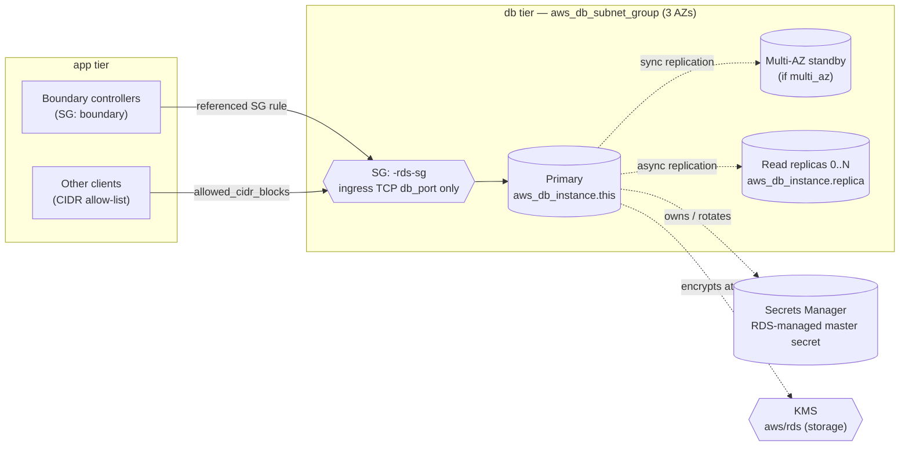
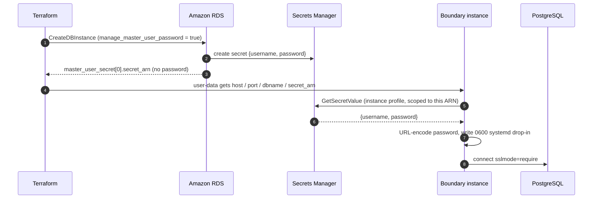

# `rds` — Managed Relational Store with Zero-Knowledge Credentials


This module provisions an Amazon RDS instance, its subnet group and security group, and optional read replicas. In this platform it backs **HashiCorp Boundary**, which stores its controller state there: scopes, host catalogs, targets, sessions, and KMS-wrapped credentials.

The module's defining property is that **Terraform never knows the database password**. The master credential is generated and rotated by RDS inside AWS Secrets Manager (`manage_master_user_password = true`). It never appears in variables, plan output or state, and consumers retrieve it at boot through their IAM instance profile.

> Back to the [platform README](../../../README.md).

---

## Contents

- [Architecture](#architecture)
- [Credential Flow](#credential-flow)
- [Usage](#usage)
- [Inputs](#inputs)
- [Outputs](#outputs)
- [Design Decisions](#design-decisions)
- [Production Hardening Checklist](#production-hardening-checklist)
- [Operations](#operations)
- [Disaster Recovery](#disaster-recovery)
- [Known Limitations](#known-limitations)

---

## Architecture



| Resource | Purpose |
| :-- | :-- |
| `aws_db_subnet_group.this` | Pins the instance to the `db` tier subnets passed in `subnet_ids`. |
| `aws_security_group.this` | Default-deny SG. Ingress is opened only on the engine port, per CIDR or per source SG. |
| `aws_vpc_security_group_ingress_rule.db-cidr` | One rule per `allowed_cidr_blocks` entry. |
| `aws_vpc_security_group_ingress_rule.db-sg` | One rule per `allowed_security_group_ids` entry. |
| `aws_db_instance.this` | Primary instance with a managed master password. |
| `aws_db_instance.replica` | `db_replica_count` same-region read replicas. |

---

## Credential Flow



The `connection` output bundles exactly what a consumer needs (`host`, `port`, `dbname`, `secret_arn`) and deliberately leaves out the password.

---

## Usage

As used by the platform in [`terraform/main.tf`](../../main.tf):

```hcl
module "rds" {
  source                  = "./modules/rds"
  project_name            = "hashicorp-stack"
  database_engine         = "postgres"
  database_engine_version = "18.3"
  database_port           = 5432
  db_instance_class       = "db.t3.micro"
  vpc_id                  = module.networking.vpc-id
  subnet_ids              = module.networking.db_subnet_ids
  username                = "hashicorp_user"
  # Evaluation posture: allows a clean `terraform destroy`. Flip both for production.
  skip_final_snapshot = true
  deletion_protection = false
}
```

Access is granted from the consumer's side. The `ec2` module takes `module.rds.security_group_id` and adds a Boundary-SG → RDS-SG rule on 5432, so the database module never needs to know who its clients are:

```hcl
module "ec2" {
  # ...
  boundary_db = {
    host       = module.rds.address
    port       = module.rds.port
    dbname     = module.rds.dbname
    secret_arn = module.rds.master_user_secret_arn
  }
  boundary_db_security_group_id = module.rds.security_group_id
}
```

Alternatively, grant access inside the module:

```hcl
allowed_security_group_ids = [aws_security_group.app.id]
allowed_cidr_blocks        = ["10.16.32.0/20"]   # prefer SG references over CIDRs
```

A production-leaning profile:

```hcl
module "rds" {
  source                    = "./modules/rds"
  project_name              = "hashicorp-stack"
  database_engine_version   = "18.3"
  database_port             = null           # use engine default (5432)
  db_instance_class         = "db.r6g.large"
  allocated_storage         = 100
  multi_az                  = true
  db_replica_count          = 1
  db_replica_instance_class = "db.r6g.large"
  skip_final_snapshot       = false
  username                  = "boundary_admin"
  vpc_id                    = module.networking.vpc-id
  subnet_ids                = module.networking.db_subnet_ids
}
```

---

## Inputs

| Name | Type | Default | Description |
| :-- | :-- | :-- | :-- |
| `project_name` | `string` | — **(required)** | Used as the DB identifier, the subnet group and SG name prefix, and to derive `db_name` (`<project>_primary_rds`, hyphens → underscores). |
| `database_engine_version` | `string` | — **(required)** | Engine version, e.g. `"18.3"`. |
| `database_port` | `number` | — **(required)** | Listener port. Pass `null` to fall back to the engine default (5432 / 3306). |
| `username` | `string` | — **(required)** | Master username. The password is **not** an input; it is managed by RDS. |
| `vpc_id` | `string` | — **(required)** | VPC for the security group. |
| `subnet_ids` | `list(string)` | — **(required)** | Subnets for the DB subnet group. Pass the `db` tier. |
| `database_engine` | `string` | `"postgres"` | One of `postgres`, `mysql`, `mariadb` (validated). |
| `db_instance_class` | `string` | `"db.t3.micro"` | Primary instance class. |
| `allocated_storage` | `number` | `20` | Storage in GiB. |
| `storage_encrypted` | `bool` | `true` | Encrypt at rest. Uses the AWS-managed `aws/rds` key. |
| `multi_az` | `bool` | `false` | Synchronous standby in a second AZ with automatic failover. Roughly doubles instance cost. |
| `db_replica_count` | `number` | `0` | Number of same-region asynchronous read replicas. |
| `db_replica_instance_class` | `string` | `"db.t3.micro"` | Instance class for replicas. |
| `allowed_cidr_blocks` | `list(string)` | `[]` | CIDRs allowed on the DB port. |
| `allowed_security_group_ids` | `list(string)` | `[]` | Source SGs allowed on the DB port. |
| `skip_final_snapshot` | `bool` | `false` | Skip the final snapshot on destroy. The module default is safe; the platform root overrides it to `true`. |
| `backup_retention_period` | `number` | `7` | Days of automated backups (0–35), which enables point-in-time recovery. Validated to be `> 0` when `db_replica_count > 0`. |
| `deletion_protection` | `bool` | `true` | Blocks deletion of the primary and replicas. The platform root overrides it to `false` for evaluation teardown. |
| `tags` | `map(string)` | `{}` | Merged onto every resource. |

## Outputs

| Name | Description |
| :-- | :-- |
| `address` | Primary endpoint hostname. |
| `port` | Listener port. |
| `username` | Master username. |
| `dbname` | Initial database name. |
| `security_group_id` | RDS security group. Add ingress rules from consumer modules. |
| `master_user_secret_arn` | ARN of the RDS-managed secret. Grant `secretsmanager:GetSecretValue` on **this ARN only**. |
| `master_user_secret_kms_key_id` | KMS key encrypting that secret. Consumers need `kms:Decrypt` if it is a CMK. |
| `kms_key_id` | KMS key used for storage encryption. |
| `replica_addresses` | Replica endpoints in index order, or `[]`. |
| `connection` | `{ host, port, dbname, secret_arn }`: everything needed to build a DSN at runtime, password excluded. |

---

## Design Decisions

**RDS-managed master password.**
Secrets Manager owns generation and rotation, and Terraform receives only an ARN. This removes the classic failure mode where a `random_password` sits in plaintext in `terraform.tfstate`. It also means **rotation never requires a Terraform apply**. Consumers re-read the secret, and Boundary picks up a rotated password on service restart.

**Consumer-owned ingress.**
The module exposes `security_group_id` and lets callers attach SG-to-SG rules. This keeps dependency edges pointing one way (the database knows nothing about Boundary) and avoids a dependency cycle between the `rds` and `ec2` modules.

**Engine-agnostic, PostgreSQL-first.**
Port defaults are derived per engine, so the module can serve MySQL or MariaDB workloads. Boundary itself **requires PostgreSQL**.

**Stable final-snapshot name.**
The final snapshot identifier is a static `<project>-final-snapshot`, so it never produces a plan diff and it takes effect as soon as `skip_final_snapshot` is flipped to `false`. If a snapshot with that name already exists from an earlier teardown, delete or rename it before destroying again. `copy_tags_to_snapshot = true` keeps cost-allocation tags on every backup.

**Private by construction.**
`publicly_accessible` is left at its default (`false`), and the subnet group should only be given `db` tier subnets.

---

## Production Hardening Checklist

The module defaults favour a low-cost evaluation footprint. Before running production controller state on it:

- [ ] `multi_az = true`: Boundary controllers stall without their database.
- [ ] `skip_final_snapshot = false` in the root module.
- [ ] `deletion_protection = true` in the root module (the module default).
- [ ] `backup_retention_period` of 7–35 days (default 7). PITR gives roughly 5-minute RPO, well inside the platform's 15-minute target.
- [ ] Use a customer-managed KMS key for storage and for the master secret, so key access is auditable and revocable.
- [ ] Enforce TLS server-side (`rds.force_ssl = 1` in a parameter group). Boundary already connects with `sslmode=require`.
- [ ] Enable Performance Insights and Enhanced Monitoring, and export PostgreSQL logs to CloudWatch.
- [ ] Right-size off burstable `t3` classes. CPU credit exhaustion shows up as controller latency.
- [ ] Enable Secrets Manager rotation on the managed secret and verify that consumers reload cleanly.

---

## Operations

```bash
# Endpoint and secret
terraform -chdir=terraform output -json | jq '.service_endpoints'
aws secretsmanager get-secret-value \
  --secret-id "$(terraform -chdir=terraform state show module.rds.aws_db_instance.this \
      | awk -F'"' '/secret_arn/{print $2}')" \
  --query SecretString --output text | jq -r .username

# Connectivity test from a Boundary node (postgresql-client is baked into the AMI)
aws ssm start-session --target <boundary-instance-id>
pg_isready -h <address> -p 5432

# Manual snapshot before risky changes (engine upgrades, class changes)
aws rds create-db-snapshot --db-instance-identifier hashicorp-stack \
  --db-snapshot-identifier hashicorp-stack-pre-change-$(date +%Y%m%d%H%M)
```

**Engine upgrades.** Minor versions can be applied in place. For **major** upgrades, snapshot first, bump `database_engine_version`, and plan for a maintenance window. Run `boundary database migrate` afterwards if the Boundary version changed too.

---

## Disaster Recovery

For the pilot-light topology in the [platform README](../../../README.md#6-disaster-recovery--failover-runbook):

| Strategy | RPO | RTO | Notes |
| :-- | :-- | :-- | :-- |
| Cross-region automated backup replication | ≈ 5–15 min (PITR) | 15–30 min (restore) | Cheapest; nothing running in DR. Matches the pilot-light cost model. |
| Cross-region read replica | seconds | ~5 min (promote) | Needs `replicate_source_db` as an **ARN** and a DR-region subnet group. Not supported by the current replica resource. |
| Manual snapshot copy | last snapshot | 15–30 min | Break-glass fallback. |

```bash
# Failover: restore to latest restorable time in the DR region
aws rds restore-db-instance-to-point-in-time --region <dr-region> \
  --source-db-instance-automated-backups-arn <replicated-backup-arn> \
  --target-db-instance-identifier hashicorp-stack-dr \
  --use-latest-restorable-time \
  --db-subnet-group-name hashicorp-stack-dr-subnet-group
```

---

## Known Limitations

| Item | Impact | Suggested fix |
| :-- | :-- | :-- |
| `database_port` has no default | Callers must pass a value or `null`, even though the module can derive it. | Add `default = null`. |
| Replicas are same-region only | `replicate_source_db` uses the identifier, which cannot address another region. | Accept a source ARN and a DR subnet group for cross-region replicas. |
| No parameter or option group | Cannot enforce `rds.force_ssl` or tune engine settings. | Add an optional `aws_db_parameter_group`. |
| AWS-managed KMS keys | Storage and the master secret use `aws/rds` and `aws/secretsmanager`, so key access cannot be scoped or revoked independently. | Accept `kms_key_id` and `master_user_secret_kms_key_id` inputs. |
