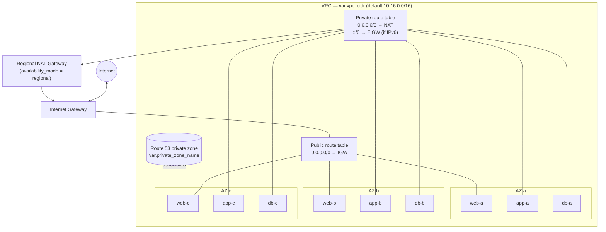

# `vpc` — Multi-AZ Tiered Network & Private DNS


This module provides the network foundation of the HashiCorp platform. It creates a three-AZ VPC with a **four-tier, deterministically addressed subnet layout**, a single **regional NAT gateway** for private egress, and a **Route 53 private hosted zone**. The private zone is the stable service-naming layer for Vault, Consul, Nomad and Boundary.

The module has one opinion: **nothing but load balancers belongs in public address space**. Workloads, control planes and databases sit in private tiers, and their only path to the internet is outbound NAT.

> Back to the [platform README](../../../README.md).

---

## Contents

- [Architecture](#architecture)
- [Address Plan](#address-plan)
- [Usage](#usage)
- [Inputs](#inputs)
- [Outputs](#outputs)
- [Design Decisions](#design-decisions)
- [Multi-Region / DR Considerations](#multi-region--dr-considerations)
- [Known Limitations](#known-limitations)

---

## Architecture



| Tier | Route table | Default route | Intended occupants (platform) |
| :-- | :-- | :-- | :-- |
| `web` | public | IGW | Internet-facing NLB only (Boundary ingress) |
| `app` | private | Regional NAT | All four ASGs and the internal NLB |
| `db` | private | Regional NAT | RDS subnet group |
| `reserved` | *(not created)* | — | Address space held back for future tiers |

---

## Address Plan

Subnets are carved with `cidrsubnet(vpc_cidr, 4, az_index * 4 + tier_offset)`. Each AZ therefore owns a contiguous block of four `/20`s, and the layout is **fully deterministic**: the same input CIDR always yields the same subnet map. That keeps addresses stable across rebuilds and makes the layout easy to reason about in security group rules, flow logs and peering route tables.

With the default `10.16.0.0/16`:

| AZ | `reserved` (offset 0) | `db` (offset 1) | `app` (offset 2) | `web` (offset 3) |
| :-- | :-- | :-- | :-- | :-- |
| a | `10.16.0.0/20` *(unallocated)* | `10.16.16.0/20` | `10.16.32.0/20` | `10.16.48.0/20` |
| b | `10.16.64.0/20` *(unallocated)* | `10.16.80.0/20` | `10.16.96.0/20` | `10.16.112.0/20` |
| c | `10.16.128.0/20` *(unallocated)* | `10.16.144.0/20` | `10.16.160.0/20` | `10.16.176.0/20` |
| *(spare)* | `10.16.192.0/18` — room for a fourth AZ block | | | |

Each `/20` provides 4,091 usable addresses (AWS reserves five per subnet), which leaves ample headroom for Nomad client scale-out and NLB ENIs.

### IPv6 (dual-stack)

When `ipv6_enabled = true`, each subnet receives `cidrsubnet(vpc_ipv6_cidr, 8, az_index * 4 + tier_offset)`. That is a `/64` at the **same index as its IPv4 `/20`**, so both address families share one mental model.

| Tier | IPv6 `/64` | Auto-assign to instances | Egress |
| :-- | :-- | :-- | :-- |
| `web` | yes | **no**: public IPv6 is internet-routable, so it's reserved for NLBs that request it | IGW (bidirectional) |
| `app` | yes | yes | Egress-only IGW (outbound only) |
| `db` | yes | yes | Egress-only IGW (outbound only) |

> Enabling IPv6 on an existing VPC associates the new `/64`s in place; it does not replace subnets. Dual-stack NLBs also need `ip_address_type = "dualstack"` in the `ec2` module.

> `vpc_cidr` must be `/16` or larger for this plan to fit (4 newbits × 16 slots). A smaller prefix makes `cidrsubnet` fail at plan time.

AZs are the first three from `aws_availability_zones` with `opt-in-status = opt-in-not-required`, which excludes Local Zones and Wavelength Zones.

---

## Usage

```hcl
module "networking" {
  source            = "./modules/vpc"
  project_name      = "hashicorp-stack"
  private_zone_name = "hashicorp-stack.internal"

  # Optional
  vpc_cidr = "10.16.0.0/16"
  tags     = { Environment = "primary", CostCenter = "platform" }
}
```

Wiring into the rest of the platform, as done in [`terraform/main.tf`](../../main.tf):

```hcl
module "rds" {
  # ...
  vpc_id     = module.networking.vpc-id
  subnet_ids = module.networking.db_subnet_ids
}

module "ec2" {
  # ...
  vpc_id             = module.networking.vpc-id
  vpc_cidr           = module.networking.vpc-cidr_block
  public_subnet_ids  = module.networking.web_subnet_ids   # external NLB only
  private_subnet_ids = module.networking.app_subnet_ids   # ASGs + internal NLB
  private_zone_id    = module.networking.zone_id
  private_zone_name  = module.networking.zone_name
}
```

Ad-hoc private records (prefer letting the `ec2` module own service records):

```hcl
records = {
  apex_txt = { name = "", type = "TXT", records = ["owner=platform"], ttl = 300 }
  grafana  = {
    name  = "grafana"
    alias = { dns_name = aws_lb.internal.dns_name, zone_id = aws_lb.internal.zone_id }
  }
}
```

---

## Inputs

| Name | Type | Default | Description |
| :-- | :-- | :-- | :-- |
| `project_name` | `string` | — **(required)** | Prefix for `Name` tags and the `Project` tag on every resource. |
| `private_zone_name` | `string` | — **(required)** | Fully qualified private zone (e.g. `hashicorp-stack.internal`). **Treat as permanent**: it ends up in TLS SANs and Boundary target addresses. Validated: at least two labels, and not `.local` (mDNS collision). A trailing dot is stripped. |
| `vpc_cidr` | `string` | `"10.16.0.0/16"` | VPC IPv4 CIDR. Must be a valid CIDR, `/16` or larger. |
| `records` | `map(object)` | `{}` | Extra records in the private zone. Each sets **exactly one** of `alias` or `records` (validated). `name = ""` targets the apex. `type` defaults to `A` and `ttl` to `60`. |
| `records_force_destroy` | `bool` | `false` | Delete all records when destroying the zone. Leave `false` in production. |
| `enable_dns_hostnames` | `bool` | `true` | Required for private hosted zone resolution and instance DNS names. |
| `enable_dns_support` | `bool` | `true` | Enables the Amazon-provided resolver (`.2`). Required for the private zone. |
| `ipv6_enabled` | `bool` | `false` | Assigns an Amazon-provided IPv6 `/56` to the VPC and a `/64` to every subnet (see [IPv6](#ipv6-dual-stack)). Adds `::/0` → IGW on the public table and `::/0` → egress-only IGW on the private table. |
| `enable_dhcp_options` | `bool` | `true` | Attaches a DHCP option set with `domain_name = "<private_zone_name> <region>.compute.internal"` and `AmazonProvidedDNS`, so short names like `vault` resolve through the private zone. |
| `map_public_ip_on_launch` | `bool` | `false` | Auto-assign public IPv4 in the **web** tier only. Off by default, because only NLBs belong there. |
| `tags` | `map(string)` | `{}` | Merged onto every resource. |

## Outputs

| Name | Description |
| :-- | :-- |
| `vpc-id` | VPC ID. |
| `vpc-arn` | VPC ARN. |
| `vpc-cidr_block` | VPC IPv4 CIDR. Used by the `ec2` module for intra-cluster security group rules. |
| `ipv6_cidr_block` | VPC IPv6 CIDR, or `null`. |
| `public_route_table_id` | Public route table ID. |
| `private_route_table_id` | Shared private route table ID. Add peering or TGW routes here for DR. |
| `web_subnet_ids` | Web-tier subnet IDs, in AZ order. |
| `app_subnet_ids` | App-tier subnet IDs, in AZ order. |
| `db_subnet_ids` | DB-tier subnet IDs, in AZ order. |
| `zone_id` | Private hosted zone ID. |
| `zone_arn` | Private hosted zone ARN. |
| `zone_name` | Zone name without the trailing dot. |
| `record_fqdns` | Map of `records` key → FQDN. |

---

## Design Decisions

**Regional NAT gateway instead of per-AZ zonal NATs.**
`availability_mode = "regional"` gives one NAT gateway that AWS spans across AZs automatically, manages Elastic IPs for (which is why the `aws_eip` block is commented out), and places without a public subnet. This keeps the private-egress path free of per-AZ single points of failure without the cost and route-table sprawl of three zonal gateways. It requires AWS provider `~> 6.0`.

**One shared private route table.**
With a regional NAT gateway there is no per-AZ egress target to differentiate, so `app` and `db` share one table. Cross-region routes for DR (peering or TGW) only need to be added in one place.

**Deterministic, tier-interleaved addressing.**
Grouping all tiers of an AZ into one contiguous `/18` (four `/20`s) means an AZ can be summarised in a single route or NACL entry. The `reserved` slot is kept for a future tier (for example, a dedicated `mgmt` or `endpoints` subnet for VPC interface endpoints) without renumbering.

**Search-domain DNS via DHCP options.**
The option set puts the private zone on every instance's resolver search path, so tooling and config can use `vault:8200` as well as the FQDN. `<region>.compute.internal` is kept alongside it so EC2 private hostnames still resolve. Instances pick up the change on their next DHCP lease renewal or reboot.

**No auto-assigned public IPs.**
Web subnets are associated with the IGW route, but `map_public_ip_on_launch` defaults to `false` (IPv4) and `assign_ipv6_address_on_creation` is always `false` (IPv6). Only the NLB, which receives its addresses from AWS, is internet-reachable. This is enforced again in the `ec2` module, where every ASG lives in the `app` tier.

**Private hosted zone as the service contract.**
Consumers address `vault.<zone>`, `consul.<zone>` and so on, never NLB DNS names or IPs. The zone name is validated up front because changing it later means regenerating certificates and Boundary targets, not a simple rename.

**`lifecycle { ignore_changes = [vpc] }` on the zone.**
This lets additional VPCs, such as a DR VPC, be associated with the zone through standalone `aws_route53_zone_association` resources without this module reverting them on the next apply.

---

## Multi-Region / DR Considerations

For the pilot-light DR region described in the [platform README](../../../README.md#6-disaster-recovery--failover-runbook):

1. **Use a non-overlapping CIDR** in the DR instantiation (for example, `10.17.0.0/16`). Consul WAN gossip, Vault replication and Nomad federation all need routed private connectivity, and overlapping ranges rule out peering and TGW.
2. **Choose one naming strategy.** Either reuse the same `private_zone_name` in both regions (each region resolves its own endpoints, so failover is transparent to clients) or associate the primary zone with the DR VPC. Do not mix the two.
3. **Add inter-region routes** to `private_route_table_id` in each region, pointing at the peering connection or TGW attachment.

```hcl
module "networking_dr" {
  source            = "./modules/vpc"
  providers         = { aws = aws.dr }
  project_name      = "hashicorp-stack-dr"
  vpc_cidr          = "10.17.0.0/16"
  private_zone_name = "hashicorp-stack.internal"
}
```

---

## Known Limitations

| Item | Impact | Suggested fix |
| :-- | :-- | :-- |
| DB tier has NAT egress | The `db` subnets share the private route table, so anything placed there can reach the internet outbound. RDS does not need this. | Give the `db` tier its own route table with no default route. |
| No VPC Flow Logs | No network audit trail for compliance or incident response. | Add `aws_flow_log` to CloudWatch Logs or S3. |
| No VPC endpoints | SSM, KMS, Secrets Manager, S3 and DynamoDB traffic traverses the NAT, which adds cost and widens the egress surface. | Add gateway endpoints (S3, DynamoDB) and interface endpoints (SSM, KMS, Secrets Manager, STS) in the `reserved` tier. |
| Fixed AZ count | `az_count = 3` is a local and cannot be overridden. | Promote it to a variable, validated to `<= 4` to fit the address plan. |
